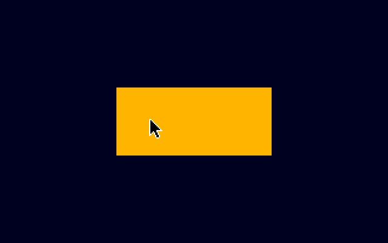
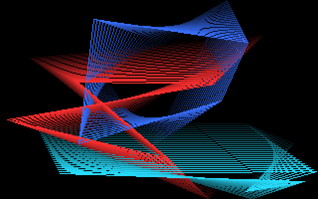
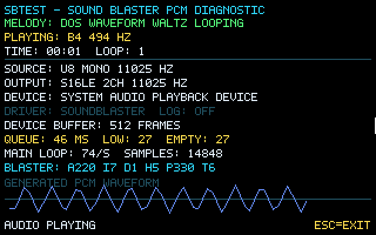
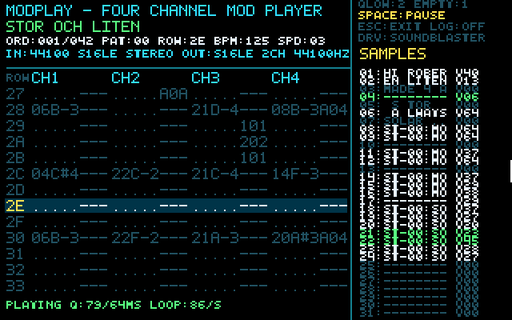
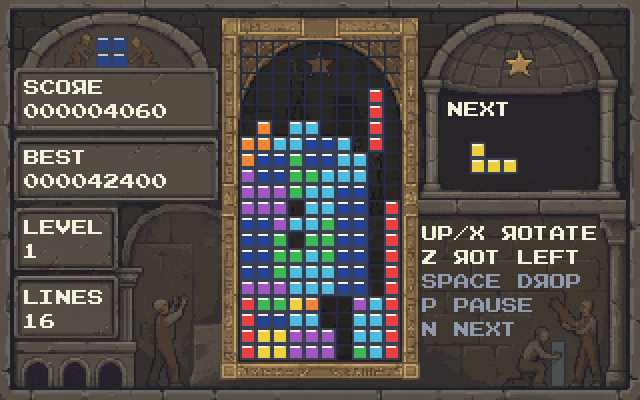
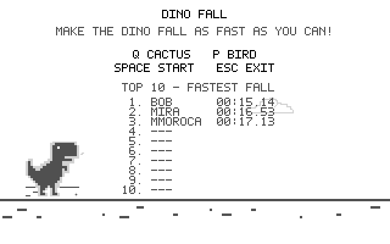
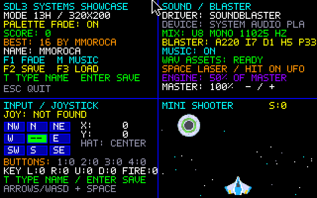
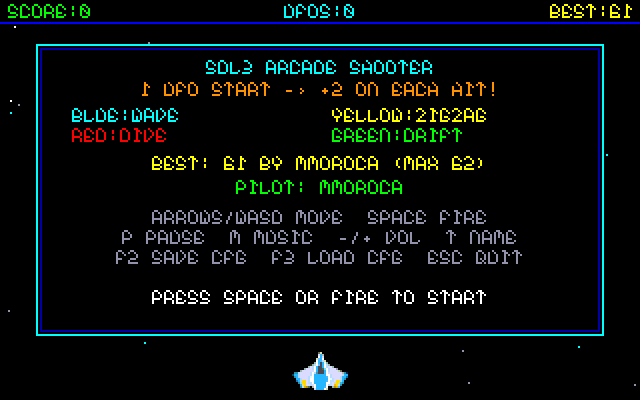

# SDL3 DOS Demo Suite

[English](README.md) · [Español](README.es.md)

**by @mmoroca & [Arena.AI](http://Arena.AI) 2026**

> [!TIP]
> **¿Usas un `80386` / `386SX` / `486SX` real con solo `2 MB` de RAM o sin coprocesador FPU?** Visita el repositorio hermano **[`mmoroca/sdl3-dos-386`](https://github.com/mmoroca/sdl3-dos-386)** — validado en un **ADL Computers Terminator 386 (`80386SX`, `2 MB` de RAM, sin `80387`)** con **cero paginación `CWSDPMI.SWP`**, ejecutables `.EXE` reducidos (`~508–574 KB`), capa reutilizable `dos_compat.c`, guía de ajuste de `CONFIG.SYS` / `AUTOEXEC.BAT` y manual completo de optimización para `386`.

Conjunto de pequeños programas en C para MS-DOS, compilados con DJGPP y el backend DOS de SDL3. SDL3 se referencia como submódulo Git fijado a un commit upstream; su código fuente permanece en el proyecto SDL y no se copia dentro de este repositorio.

## Programas incluidos

| Ejecutable | Fuente | Descripción y controles |
|---|---|---|
| `HELLO.EXE` | `main.c` | Ejemplo mínimo de superficie SDL a 320×200. Dibuja un rectángulo de color y sale con **Esc** o al cerrar la ventana; `/L` activa opcionalmente `HELLO.LOG`. |
| `FONTDEMO.EXE` | `fontdemo.c` | Muestra comparativa en 320×200 de las cuatro fuentes bitmap en cabeceras C (`font_3x5.h`, `font_5x7.h`, `nueva_font_5x7.h` y `font_8x8.h`). **Esc** sale. |
| `MISTIFY.EXE` | `mistify.c` | Cuadriláteros animados con paleta de 256 colores y estelas degradadas. Valores predeterminados: 48 fotogramas de estela, 2 polígonos y velocidad normal. Sale al pulsar cualquier tecla o mover el ratón. `/L` activa `MISTIFY.LOG`. |
| `SBTEST.EXE` | `soundtest.c` | Reproduce una melodía original generada como PCM mono sin signo de 8 bits a 11025 Hz y muestra diagnósticos de audio/dispositivo. **Esc** sale; `/L` activa `SBTEST.LOG`. |
| `MODPLAY.EXE` | `modplay.c` | Reproduce módulos ProTracker dentro de estos límites: 31 muestras y 4 canales. Salida predeterminada: 22050 Hz, 8 bits, mono. **Space** pausa/reanuda y **Esc** sale. |
| `SHOWCASE.EXE` | `showcase.c` | Plantilla SDL3 organizada en funciones: pantalla indexada 320×200, fundido de paleta, entrada de texto/teclado, joystick opcional de ocho direcciones, diagnóstico y efectos de audio PCM, configuración/récord guardados y mini shooter en cuatro paneles. **Flechas/WASD** mueven, **Space** dispara, **T** edita el nombre, **F1** aplica el fundido, **M** activa/desactiva la música, **F2/F3** guardan/cargan ajustes, **-/+** cambia el volumen y **Esc** sale; `/L` activa `SHOWCASE.LOG`. |
| `SHOOTER.EXE` | `shooter.c` | Shooter arcade independiente a pantalla completa (320×200) basado en `showcase.c`. Tras el logotipo SDL3-DOS muestra `SHOWCASE/UFO.BMP` durante 5 s (**Esc** salta directamente al menú) y empieza la partida con 1 UFO en uno de 4 patrones identificados por color; cada baja genera 2 UFO nuevos (hasta 256 simultáneos) hasta chocar con la nave. **Flechas/WASD** o joystick mueven, **Space**/botón 1 inicia/dispara, **P** pausa, **T** edita el nombre, **M**/**-/+** ajustan el audio, **F2/F3** guardan/cargan y **Esc** pide confirmación `"EXIT? Y / N"` en partida, vuelve al menú en Game Over y desde el menú principal sale con fundido e imprime `"¡Gracias por jugar!"` en modo texto DOS; `/L` activa `SHOOTER.LOG`. |
| `SKYHOP.EXE` | `skyhop.c` | Plataformas procedurales independientes a 320×200 para 486+; **A/D/flechas** mueven, **Espacio/W/arriba** saltan, **P** pausa, **Esc** vuelve al menú. Top 10 por tiempo sobrevivido. |
| `TETSDL3.EXE` | `tetrisdl3.c`, `tetris_rules.h`, `tetris_scores.h` | Arcade 486+ de bloques: tablero 10×20, logo y título de 3 s cada uno, líneas parpadeantes, efectos y música Kenney CC0, Top 10 con nombre y pantallas de menú/récords que alternan cada 5 segundos. [Guía](TETRISDL3_DESIGN.md). |
| `DINO.EXE` | `dinorun.c` | El corredor intenta esquivar automáticamente; la agilidad aleatoria puede hacer que falle el momento. Coloca un cactus con **Q** o un pájaro con **P**. Los sprites se muestran por defecto a media escala (`/s 2`); `/h` muestra la ayuda. **Space** inicia/pausa y **Esc** sale. El Top 10 ordena primero los tiempos más cortos. |
| `VTEST.EXE` | `vtest.c`, `vtest_chart.h` | **Carta de ajuste** 486+ para modos BIOS VGA/VBE y SDL3 entre 320×200 y 1024×768, con profundidades disponibles. **B/K/S** seleccionan BIOS/BIOS bancario/SDL3, **Intro** inicia; 10 segundos o **Esc** para volver al menú; **Esc** desde menú sale. `/LIST`, `/LISTSDL` enumeran modos. [Guía bilingüe](VTEST_GUIDE.md). |

Dino, Shooter y SKYHOP muestran primero el logotipo SDL3-DOS reutilizable durante tres segundos, con fade-in, voz al alcanzar el brillo completo y fade-out; Esc salta solo esta pantalla. Para usarlo en otro programa SDL3, copia `sdl3_splash.h` y `SPLASH/`; consulta la [guía bilingüe de integración](SDL3_SPLASH_GUIDE.md). Shooter mantiene después su pantalla UFO original de cinco segundos. `/H` presenta la ayuda directamente. La función del encabezado reutiliza la ventana, el canvas INDEX8 y, si lo hay, el flujo de audio del juego; después restaura su paleta. No crea otra sesión SDL ni altera las mediciones `/L` de SKYHOP.

## TETRISDL3: arcade ilustrado 486+, récords y sonido

Ejecuta `TETSDL3.EXE` con `SPLASH/` y `TETRIS/` al lado. Logo SDL3-DOS prestando recursos durante tres segundos (Esc lo salta), seguido de portada ilustrada independiente de tres segundos, con **entrada por fundido de ~320 ms** y **sin el texto ENTER SPACE ESC** (Enter/Espacio/Esc sigue abriendo el menú al instante con brillo completo). **MENÚ y TOP 10 son pantallas independientes que alternan cada cinco segundos**: Enter inicia y Esc sale desde cualquiera. En partida, izquierda/derecha mueven, abajo cae lentamente, **Arriba o X giran a la derecha**, Z gira a la izquierda, Espacio fija una caída instantánea, P pausa, N alterna NEXT y Esc **congela la partida o los tres destellos** para mostrar `PAUSED / EXIT? Y / N`. Y abandona, N reanuda exactamente el estado previo; Esc dentro de la pregunta cancela como N. Durante el destello, Y abandona **sin terminar la limpieza pendiente**. Ambas rotaciones se muestran en menú **y** HUD. `/H` imprime ayuda; `/L` activa opcionalmente `TETSDL3.LOG` para fases/errores (desactivado por defecto).

Limpiar 1/2/3/4 filas concede 40/100/300/1200 × (nivel anterior + 1) puntos; el nivel inicial es 0 y sube cada diez líneas. La gravedad sigue la tabla acordada a 60 pasos lógicos/s (nivel 9 = **6** ticks; 29+ = **1**), con bloqueo tras un intervalo completo y sin *wall kicks*. La fila llena **parpadea tres veces durante ~0,5 s**, desaparece y **solo entonces** se puntúa, actualiza el nivel y sale la siguiente pieza. El primer apoyo activa `FALL.WAV`, la rotación válida `CLICK.WAV`, la derrota `OVER.WAV`, la subida de nivel `LEVEL.WAV` y limpiar cuatro filas `TETRIS.WAV`. Se mezclan los efectos simultáneos en un único stream SDL; si no hay dispositivo de audio se puede jugar en silencio, pero un WAV ausente o incorrecto informa su nombre y detiene el arranque.

Una puntuación mayor que cero que entre en el Top 10 **al perder o al confirmar el abandono con Y** pide un nombre de 1–8 caracteres A–Z/0–9; Retroceso edita, Enter guarda y muestra la pantalla separada de récords, y Esc cancela sin escribir. Los empates mantienen delante la entrada anterior. `TETSDL3.SCO` guarda hasta diez récords con nombre, nivel y puntos en el único formato admitido. Un archivo desconocido/incorrecto se indica y se deja intacto al leerlo; el juego continúa con tabla vacía. En pantalla **siempre aparecen los puestos 1–10**: donde faltan entradas se muestran `........` (nombre), `..` (nivel) y `.........` (puntos), sin guardar esas marcas en el archivo. Se emplean `TETSDL3.TMP` y copia temporal `TETSDL3.BAK`; cerrar directamente la ventana no puede asignar nombre a una puntuación. Ejecuta desde un directorio con permiso de escritura.

El menú y Top 10/entrada de nombre usan ahora **el mismo** muro original del usuario, `tetris-src/menu-juego-tetsdl3.png` → `TETRIS/RECORDS.BMP`, con zona oscurecida idéntica `x=20,y=16,w=280,h=162`. El texto **ENTER START** del menú y la cabecera **TOP 10** tienen sombra oscura desplazada un píxel. Solo el menú superpone el nuevo logotipo adjunto **111×25** `tetris-src/logo tetris mini.png` → `TETRIS/LOGO.BMP`, centrado horizontalmente con el **borde superior en y=29**; récords mantiene su cabecera TOP 10. El índice 0 transparente deja ver el muro oscuro entre las letras. Ya no se usa `MENU.BMP` ni un texto de cabecera adicional; el antiguo `tetris-src/MENU.png` se conserva intacto como alternativa no utilizada. `TITLE.BMP` deriva del nuevo **`TITLE.png`** (sustituye el PNG v4 y corrige el texto ARCADE) y `GAME.BMP` de `fondo-juego-tetsdl3.png`. La página de récords sigue sin «ENTER PLAY ESC QUIT» ni banda sombreada inferior, aunque sus teclas funcionan. Los cuatro BMP DOS obligatorios `TETRIS/{TITLE,RECORDS,GAME,LOGO}.BMP` comparten la paleta generada `fonts/tetris_art_palette.h`: regenera todos juntos con `python3 tools/convert_tetris_art.py tetris-src TETRIS fonts/tetris_art_palette.h` (solo Python estándar; sin Pillow). El conversor borra el `TETRIS/MENU.BMP` obsoleto; elimínalo manualmente si copias a una carpeta DOS anterior. Un BMP ausente/incorrecto muestra su nombre en formato DOS, `TETRIS\NOMBRE.BMP`. Si los recursos no han cambiado pero un EXE reconstruido falla en la comparación de paleta, regenera el árbol de compilación y copia el EXE nuevo con los cuatro BMP y la cabecera coherentes. Los cambios solo de textos/sombras **no** exigen reconvertir el arte. El arte del usuario no es automáticamente MIT o Kenney CC0; véanse los [avisos](THIRD_PARTY_NOTICES.md). El conversor genérico RGB 3:3:2 de otros ejemplos permanece intacto.

El propietario confirmó **Kenney CC0 1.0** tanto para los cinco efectos anteriores como para las dos nuevas pistas [`Retro Beat.ogg`](docs/Retro%20Beat.ogg) y [`Retro Polka.ogg`](docs/Retro%20Polka.ogg). `sh tools/convert_tetris_audio.sh docs TETRIS` usa FFmpeg fuera del juego para crear cinco WAV de efectos y `TETRIS/BEAT.WAV` y `POLKA.WAV` (U8 mono 11025 Hz); los OGG siguen intactos. En el mismo stream SDL, Beat se repite sin reiniciarse entre portada, menú, Top 10 y entrada de nombre; Polka se repite durante partida, destellos **y pausa con P o con la pregunta de salida**. Polka se detiene al terminar o abandonar. Los cinco efectos se mezclan con la música. Un WAV ausente/incorrecto detiene el arranque indicando su nombre; sin dispositivo de audio se puede jugar en silencio. Los siete medios OGG/WAV conservan CC0; el código propio, MIT; SDL3 upstream, zlib. El splash tiene términos distintos sin verificar. [Avisos](THIRD_PARTY_NOTICES.md).

Esc desde menú o Top 10 **funde la paleta a negro durante ~320 ms**; después cierra SDL, restaura la consola MS-DOS en modo texto y muestra exactamente `Thank you for playing!`. La entrada/salida por fundido, como en Shooter, será la pauta para nuevos minijuegos salvo indicación contraria; no se abre otra sesión SDL.

Con SDL3-DOS upstream/submódulo y DJGPP, sigue los pasos Release siguientes y ejecuta `cmake --build "$DEMO_DIR/build-dos" --target tetsdl3`. Para pruebas nativas, configura `-DTETRIS_BUILD_TESTS=ON`, compila `tetris_rules_tests tetris_scores_tests tetris_app_tests` y ejecuta `ctest --test-dir build-native --output-on-failure`. Reglas y récords se prueban incluso sin SDL. No se exige Pillow. DOSBox-X no demuestra rendimiento de un 486 real; la edición 386 no se modifica.

## Capturas de pantalla

| Demo | Captura |
|---|---|
| `HELLO.EXE` |  |
| `MISTIFY.EXE` |  |
| `SBTEST.EXE` |  |
| `MODPLAY.EXE` |  |
| `TETSDL3.EXE` |  |
| `DINO.EXE` |  |
| `SHOWCASE.EXE` |  |
| `SHOOTER.EXE` |  |

Las demos arcade solicitan superficies indexadas de 320×200 cuando están disponibles; **VTEST.EXE** prueba por separado los modos VGA/VBE anunciados hasta 1024×768 por BIOS y SDL3. Mistify dibuja con una paleta de 256 colores; Dino Fall usa una paleta compartida de grises y una clave de transparencia; Showcase y Shooter usan una paleta RGB 3:3:2 para sus BMP convertidos; SKYHOP usa una paleta propia de colores exactos e índice transparente 0. Estos programas usan superficies SDL por software; el backend DOS utiliza VGA/VESA y no necesita OpenGL ni aceleración de GPU. Los textos y la ayuda visibles dentro de los programas están en inglés.

## Organización del código

Cada archivo C está organizado en secciones visibles para la configuración, el estado, la inicialización, la entrada, el bucle principal y la limpieza. `dinorun.c` documenta el estado, la propiedad de los recursos, los tiempos/física, la maniobra aleatoria, las máscaras de colisión, el dibujo y el flujo de eventos. `showcase.c` es la plantilla funcional: separa pantalla/paleta, dibujo de texto, teclado, joystick, audio, ficheros, actualización/dibujo del shooter, bucle principal y limpieza. `shooter.c` convierte esa base en un juego arcade independiente a pantalla completa usando aritmética entera/en coma fija y colisión precisa por píxel opaco. Consulta [`SHOWCASE_GUIDE.md`](SHOWCASE_GUIDE.md) para el mapa bilingüe de funciones y sugerencias de extensión. `tools/convert_assets.py` sigue siendo genérico; `trimexe.sh` crea copias reducidas sin modificar los originales. Los recursos se liberan de forma segura aunque falle una etapa de inicialización; no se usan sentencias `goto`.

## Requisitos

- CMake 3.16 o posterior.
- Git.
- Un compilador cruzado DJGPP cuyo destino sea `i386-pc-msdosdjgpp`, incluidos sus binutils.
- El submódulo Git de SDL3 en `SDL/`, fijado a un commit upstream que contiene el backend DOS y el archivo `build-scripts/i586-pc-msdosdjgpp.cmake`. SDL3 **no está vendorizado** en el proyecto; el repositorio solo registra el puntero al submódulo. Al clonar, inicialízalo para obtener la revisión exacta registrada.
- Para probar en DOS, un host DPMI como `CWSDPMI.EXE`. Los ejemplos de audio requieren también una Sound Blaster compatible o una configuración de emulación equivalente.

CMake busca SDL3 en `SDL/` de forma predeterminada. Para usar un checkout en otra ubicación, pasa `-DSDL3_DOS_SOURCE_DIR=/ruta/a/SDL` al configurar.

## Preparar un toolchain DJGPP

Se puede usar cualquier toolchain DJGPP compatible. Lo siguiente es una receta opcional para macOS/Homebrew con [build-gcc](https://github.com/jwt27/build-gcc); en otros sistemas anfitriones, instala los requisitos equivalentes documentados por ese proyecto o usa un toolchain DJGPP ya instalado.

En macOS, instala las herramientas de línea de comandos y las utilidades necesarias:

```sh
xcode-select --install   # only if the tools are not already installed
brew install bash gnu-sed texinfo nasm dos2unix cmake git
```

Define una ruta de instalación configurable, clona `build-gcc` ahí una sola vez y compila el toolchain DJGPP mínimo. El valor predeterminado de abajo está bajo el directorio personal del usuario; puedes cambiar `BUILD_ROOT`.

```sh
export BUILD_ROOT="${BUILD_ROOT:-$HOME/build-gcc}"

if [ ! -d "$BUILD_ROOT/.git" ]; then
  git clone https://github.com/jwt27/build-gcc.git "$BUILD_ROOT"
fi

export DJGPP_PREFIX="${DJGPP_PREFIX:-$BUILD_ROOT/opt/djgpp}"
export PATH="$(brew --prefix bash)/bin:$(brew --prefix nasm)/bin:$(brew --prefix dos2unix)/bin:$(brew --prefix gnu-sed)/libexec/gnubin:$(brew --prefix texinfo)/bin:$PATH"
cd "$BUILD_ROOT"
"$(brew --prefix bash)/bin/bash" ./build-djgpp.sh --prefix="$DJGPP_PREFIX" minimal
```

Usa el objetivo `minimal` para este proyecto; el objetivo más amplio `all` puede intentar compilar el agregado heredado `djgpp/default`. El prefijo debe ser una ruta absoluta. En Linux u otro sistema anfitrión, instala las dependencias de compilación correspondientes y sigue las instrucciones específicas de ese sistema en la documentación de `build-gcc`, o configura `DJGPP_PREFIX` para usar un toolchain existente.

## Configurar una terminal y obtener las fuentes

Define las ubicaciones del proyecto y del toolchain en cada terminal que uses para compilar. Estos valores predeterminados son ejemplos y se pueden cambiar; `DEMO_DIR` se define explícitamente para que los comandos de compilación no dependan del directorio actual.

```sh
export BUILD_ROOT="${BUILD_ROOT:-$HOME/build-gcc}"
export DEMO_DIR="${DEMO_DIR:-$HOME/sdl3-dos-demo}"
export DJGPP_PREFIX="${DJGPP_PREFIX:-$BUILD_ROOT/opt/djgpp}"
export SDL3_DOS_SOURCE_DIR="${SDL3_DOS_SOURCE_DIR:-$DEMO_DIR/SDL}"

export DJDIR="$DJGPP_PREFIX/i386-pc-msdosdjgpp"
export GCC_EXEC_PREFIX="$DJGPP_PREFIX/lib/gcc/"
export PATH="$DJGPP_PREFIX/i386-pc-msdosdjgpp/local/bin:$DJGPP_PREFIX/i386-pc-msdosdjgpp/bin:$DJGPP_PREFIX/bin:$PATH"
export PKG_CONFIG_LIBDIR="$DJGPP_PREFIX/i386-pc-msdosdjgpp/local/lib/pkgconfig:$DJGPP_PREFIX/i386-pc-msdosdjgpp/local/share/pkgconfig:$DJGPP_PREFIX/i386-pc-msdosdjgpp/lib/pkgconfig:$DJGPP_PREFIX/i386-pc-msdosdjgpp/share/pkgconfig"
unset PKG_CONFIG_PATH
```

Comprueba que el compilador genera código para DJGPP:

```sh
i386-pc-msdosdjgpp-gcc -v 2>&1 | grep Target
```

La salida debe contener `Target: i386-pc-msdosdjgpp`. Clona el proyecto e inicializa su submódulo SDL3 fijado, o inicializa el submódulo en un checkout existente:

```sh
# Replace the project URL if the GitHub owner or repository name differs.
if [ ! -d "$DEMO_DIR/.git" ]; then
  git clone --recurse-submodules https://github.com/mmoroca/sdl3-dos-demo.git "$DEMO_DIR"
else
  git -C "$DEMO_DIR" submodule update --init --recursive
fi

export SDL3_DOS_SOURCE_DIR="${SDL3_DOS_SOURCE_DIR:-$DEMO_DIR/SDL}"
```

El checkout del submódulo queda fijado por el repositorio principal, así que `git submodule update --init --recursive` restaura exactamente la revisión registrada de SDL. Si usas un checkout de SDL independiente, define `SDL3_DOS_SOURCE_DIR` con esa ruta.

## Perfiles de compilación

El checkout de SDL proporciona el archivo de toolchain CMake para DOS. El compilador se indica explícitamente como el compilador C de DJGPP; este proyecto solo usa C.

### Compilación Release normal

```sh
cmake -S "$DEMO_DIR" -B "$DEMO_DIR/build-dos" \
  -DSDL3_DOS_SOURCE_DIR="$SDL3_DOS_SOURCE_DIR" \
  -DCMAKE_TOOLCHAIN_FILE="$SDL3_DOS_SOURCE_DIR/build-scripts/i586-pc-msdosdjgpp.cmake" \
  -DCMAKE_BUILD_TYPE=Release \
  -DCMAKE_C_COMPILER="$DJGPP_PREFIX/bin/i386-pc-msdosdjgpp-gcc"

cmake --build "$DEMO_DIR/build-dos" --parallel
```

El archivo de toolchain se llama `i586-pc-msdosdjgpp.cmake`; el compilador se indica explícitamente como `i386-pc-msdosdjgpp-gcc`. CMake genera `hello.exe`, `mistify.exe`, `sbtest.exe`, `modplay.exe`, `showcase.exe`, `shooter.exe`, `skyhop.exe`, `tetsdl3.exe`, `dino.exe` y `vtest.exe` dentro del directorio de compilación elegido. También copia la carpeta de recursos `SHOWCASE/` junto a los ejecutables para `showcase.exe` y `shooter.exe`. Si cambias de compilador o toolchain después de configurar, usa un directorio de compilación nuevo para que CMake no reutilice la caché anterior.

### Compilación Release optimizada para tamaño

Usa un directorio separado para conservar intacta la compilación normal:

```sh
cmake -S "$DEMO_DIR" -B "$DEMO_DIR/build-dos-small" \
  -DSDL3_DOS_SOURCE_DIR="$SDL3_DOS_SOURCE_DIR" \
  -DCMAKE_TOOLCHAIN_FILE="$SDL3_DOS_SOURCE_DIR/build-scripts/i586-pc-msdosdjgpp.cmake" \
  -DCMAKE_BUILD_TYPE=Release \
  -DCMAKE_C_COMPILER="$DJGPP_PREFIX/bin/i386-pc-msdosdjgpp-gcc" \
  -DCMAKE_C_FLAGS_RELEASE="-Os -DNDEBUG -ffunction-sections -fdata-sections" \
  -DCMAKE_EXE_LINKER_FLAGS="-Wl,--gc-sections"

cmake --build "$DEMO_DIR/build-dos-small" --parallel
```

`-Os` prioriza un menor tamaño de código; las secciones separadas de funciones/datos y `--gc-sections` permiten descartar secciones sin uso. Si el enlazador del toolchain no admite `--gc-sections`, quita esa opción y las opciones de secciones; puedes conservar `-Os -DNDEBUG`. Este perfil no solicita instrucciones exclusivas de 486.

#### Crear copias sin símbolos

Después de compilar, `trimexe.sh` crea copias reducidas de los ejecutables de una carpeta sin modificar los originales:

```sh
bash "$DEMO_DIR/trimexe.sh" "$DEMO_DIR/build-dos-small"
```

Solo examina esa carpeta, no las subcarpetas; acepta extensiones `.exe` y `.EXE`. Añade `str.exe` al nombre base (por ejemplo, `dino.exe` produce `dinostr.exe`). Ejecuta `i386-pc-msdosdjgpp-strip --strip-all`, que elimina de las copias la tabla de símbolos, incluidos los símbolos de depuración. Omite los archivos que ya terminan en `str.exe`, por lo que se puede repetir sin volver a procesar las salidas. El binario `strip` de DJGPP debe estar en `PATH`; puedes indicar otra ruta mediante `STRIP_TOOL=/ruta/a/i386-pc-msdosdjgpp-strip`. Consulta `bash "$DEMO_DIR/trimexe.sh" --help` para ver el uso.

### Compilación Release para rendimiento en 486 o superior

Este perfil independiente prioriza la velocidad frente al tamaño y genera código para procesadores 486 o posteriores; no es compatible con un 386.

```sh
cmake -S "$DEMO_DIR" -B "$DEMO_DIR/build-dos-fast" \
  -DSDL3_DOS_SOURCE_DIR="$SDL3_DOS_SOURCE_DIR" \
  -DCMAKE_TOOLCHAIN_FILE="$SDL3_DOS_SOURCE_DIR/build-scripts/i586-pc-msdosdjgpp.cmake" \
  -DCMAKE_BUILD_TYPE=Release \
  -DCMAKE_C_COMPILER="$DJGPP_PREFIX/bin/i386-pc-msdosdjgpp-gcc" \
  -DCMAKE_C_FLAGS_RELEASE="-O2 -DNDEBUG -march=i486 -mtune=i486 -ffunction-sections -fdata-sections" \
  -DCMAKE_EXE_LINKER_FLAGS="-Wl,--gc-sections"

cmake --build "$DEMO_DIR/build-dos-fast" --parallel
```

Para comparar `-O3`, usa otro directorio (por ejemplo, `build-dos-fast3`) y sustituye `-O2` por `-O3`; no sobrescribas una compilación configurada con flags distintos.

En una prueba reportada con un 486 DX2/50, `MODPLAY.EXE` funcionó holgadamente a 22050 Hz, 16 bits, estéreo. A 44100 Hz, 16 bits, estéreo, la prueba con `-O2` generó unos 44.150 frames/s y tuvo un tiempo máximo de rellenado de audio de 61 ms; con `-O3` generó unos 45.090 frames/s y el máximo fue de 57 ms. La cola objetivo es de unos 65 ms, por lo que a la tasa más alta queda poco margen. Son mediciones de hardware concreto, no garantías de rendimiento.

### Edición independiente para 80386 / 386SX con poca memoria

Este repositorio mantiene sus fuentes C limpios, legibles y libres de parches dependientes del hardware (orientados a equipos DOS 486 o superiores y sistemas actuales). En el directorio paralelo `../sdl3-dos-386` se ofrece una edición independiente específica para `80386` / `386SX` sin FPU y con presupuesto estricto de 2 MB de RAM (binarios reducidos, sprites pre-escalados y capa de compatibilidad VGA/PIT).

## Ejecución en DOS o DOSBox

DJGPP genera ejecutables DPMI de 32 bits. Proporciona un host DPMI compatible, como `CWSDPMI.EXE`, junto a los programas, salvo que el entorno de ejecución ya incluya uno. Monta el directorio de compilación elegido como unidad `C:` en DOSBox o DOSBox-X.

```text
C:
HELLO.EXE
HELLO.EXE /L
HELLO.EXE /H
```

`HELLO.EXE` abre una pantalla VGA indexada de 320×200, dibuja su patrón de prueba y espera hasta 5 segundos (o sale al instante al pulsar **Esc**). El registro en `HELLO.LOG` está desactivado por defecto y solo se activa pasando `/L` (`/LOG`, `-l`, `--log`).

### Muestra comparativa de fuentes bitmap

```text
FONTDEMO.EXE
```

`FONTDEMO.EXE` compara simultáneamente en 320×200 las cuatro fuentes bitmap en cabeceras C del proyecto (`font_3x5.h`, `font_5x7.h`, `nueva_font_5x7.h` y `font_8x8.h`), generadas desde tiras PNG con `tools/genfont.py`. Pulsa **Esc** para volver limpiamente al símbolo del sistema de MS-DOS.

En `python3 tools/genfont.py`, selecciona un glifo y pulsa **Copiar** (o Ctrl+C / Cmd+C); selecciona otro carácter, por ejemplo R, y pulsa **Pegar** (Ctrl+V / Cmd+V). Los píxeles copiados forman un **borrador editable** de R, sin cambiar su código ni el glifo de origen. Pulsa **OK** para incorporar el resultado a la fuente C exportada. Pegar sobre un dibujo no vacío pide confirmación; los atajos respetan el copiado y pegado de texto dentro de los campos. El portapapeles interno de glifos requiere el mismo tamaño de rejilla.

### Plantilla Systems Showcase

```text
SHOWCASE.EXE
SHOWCASE.EXE /L
SHOWCASE.EXE /H
```

`SHOWCASE.EXE` solicita al backend DOS de SDL3 una pantalla indexada de 320×200 (estilo Modo 13h; no ejecuta interrupciones BIOS) y aumenta gradualmente la paleta RGB 3:3:2 desde negro hasta el brillo completo. Cuatro paneles muestran el estado general y texto multicolor, diagnósticos de audio/`BLASTER`, entrada de teclado/texto/joystick y un shooter con estrellas sobre fondo negro. Los tres sprites de Kenney son BMP indexados dibujados a escala 1:4 (nave 28×19, UFO 23×23, láser 4×10). La música y los efectos OGG originales se suministran como WAV mono sin signo de 8 bits a 11025 Hz; el objetivo DOS usa el audio del SDL3 básico y no enlaza SDL3_mixer. Consulta [`SHOWCASE_GUIDE.md`](SHOWCASE_GUIDE.md) para la justificación y la alternativa con SDL3_mixer.

Controles: **flechas/WASD** mueven; **Space** o el botón 1 del joystick dispara; **T** inicia la escritura del nombre, **Backspace** borra y **Enter** lo guarda; **F1** activa/desactiva el fundido; **M** activa/desactiva la música; **F2/F3** guardan/cargan `SHOWCASE.CFG`; **-/+** cambia el volumen general; **Esc** sale con fundido de paleta. El clip del motor se mezcla exactamente al 50 % del volumen general. Un nuevo récord del shooter se guarda inmediatamente en `SHOWCASE.SCO`. Ambos son archivos de datos de texto del directorio actual e ignorados por Git. El joystick es opcional: si no hay uno, se indica en pantalla y el teclado sigue funcionando. Consulta [`SHOWCASE_GUIDE.md`](SHOWCASE_GUIDE.md) para el mapa de funciones y la conversión de recursos.

### Arcade Shooter

```text
SHOOTER.EXE
SHOOTER.EXE /L
SHOOTER.EXE /H
```

`SHOOTER.EXE` convierte la base de `showcase.c` en un shooter arcade independiente a pantalla completa (320×200). Después de la nueva entradilla SDL3-DOS muestra durante 5 segundos la pantalla de presentación indexada a tamaño completo `SHOWCASE/UFO.BMP` (`showcase-src/UFO.png`) antes de pasar al menú de título, y pre-escala a 1:4 los seis BMP de juego (`PLAYER~1.BMP`, `UFOBLUE.BMP`, `UFOYEL~1.BMP`, `UFORED.BMP`, `UFOGREEN.BMP` y `LASERR~1.BMP`) en búferes contiguos compactos para aprovechar la caché L1 de un 486 incluso con cientos de enemigos en pantalla. Mezcla los WAV PCM mono a 11025 Hz usando exclusivamente aritmética entera y en coma fija 24.8 (sin requerir FPU), mantiene oculto el puntero del ratón y, al pulsar **Esc**, funde la paleta a negro, restaura el modo texto MS-DOS (`SDL_Quit`) e imprime `"Gracias por jugar!"` justo antes del prompt de MS-DOS (se elimina el fundido manual con `F1`; `F2`/`F3` guardan/cargan `SHOOTER.CFG`).

Cada partida comienza con **1 UFO** descendiendo desde arriba con uno de cuatro comportamientos identificables por su color: **azul** = onda sinusoidal, **amarillo** = zigzag diagonal temporizado, **rojo** = picado rápido alternado y **verde** = deriva diagonal con cambios de rumbo. Al destruir un enemigo se suma un punto y aparecen inmediatamente **2 UFO nuevos** (`ENEMIES_PER_KILL = 2`, con hasta `MAX_ENEMIES = 256` enemigos activos simultáneos más cola de reserva). Los enemigos que alcanzan el borde inferior reaparecen arriba con nueva posición X y comportamiento/color aleatorio. Las colisiones comprueban píxeles opacos tras un descarte rápido de cajas; la partida termina de inmediato cuando algún sprite enemigo impacta con la nave del jugador. Los ajustes y récords se guardan en `SHOOTER.CFG` y `SHOOTER.SCO`; el parámetro opcional `/L` (o `/LOG`) activa el registro de arranque/resumen en `SHOOTER.LOG` (desactivado por defecto, sin escritura en disco por fotograma e ignorado por Git).

### Entradilla reutilizable SDL3-DOS

La función de [`sdl3_splash.h`](sdl3_splash.h) se ejecuta **después** de inicializar el vídeo/audio de Dino, Shooter y SKYHOP, pero antes de sus bucles de juego. No abre otra ventana, lienzo de dibujo ni dispositivo de sonido (SDL_LoadBMP carga una superficie temporal para la imagen). Conserva `SPLASH/SDL3DOS.BMP` y `SPLASH/ZARVOX.WAV` junto al ejecutable. Usa temporalmente los 12 colores exactos del logo sobre el canvas del juego y después restaura su paleta. El logo aparece en 0,5 s, permanece 2 s y desaparece en 0,5 s (**3 s en total**); el WAV de ~0,94 s empieza al terminar el fade-in. Esc pasa directamente al juego, cerrar la ventana sale; si falta audio se muestra en silencio y si faltan recursos de entradilla el juego continúa. Regenera los recursos desde `splash-src/` con `python3 tools/convert_sdl3_splash.py splash-src SPLASH` (solo biblioteca estándar). Consulta [SDL3_SPLASH_GUIDE.md](SDL3_SPLASH_GUIDE.md) para copiar la función, conocer los requisitos de audio y probarla. La imagen y el audio tienen procedencia propia; la licencia MIT del código no se les aplica automáticamente.

### SKYHOP — plataformas sin fin (486+)

La [guía bilingüe del código de SKYHOP](SKYHOP_GUIDE.md) ofrece un recorrido por las funciones, una **tabla de transiciones entre fases**, la explicación de los tiempos y los pasos para recompilarlo o adaptarlo. Los comentarios de `skyhop.c` siguen la misma estructura.

```text
SKYHOP.EXE
SKYHOP.EXE /H
SKYHOP.EXE /L
```

**Espacio/Intro** inicia; **A/D o flechas izquierda/derecha** mueven; **Espacio, W o arriba** saltan (soltar antes del siguiente salto); **P** pausa/reanuda; **Esc** vuelve de la partida/pausa a la portada, o sale desde la portada. Tras perder, escribe hasta ocho caracteres **A–Z/0–9** (Retroceso borra) y pulsa **Intro** para guardar un tiempo clasificado. Los **10 tiempos de supervivencia más largos** se ven en la portada y se guardan en milisegundos en `SKYHOP.SCO`, en el **directorio de trabajo actual**; Git lo ignora. Cada fila de la portada reserva 2 caracteres para el puesto, 8 para el nombre y un tiempo fijo `000.0S`; al superar 999,9 segundos se muestra `999.9S`, pero se conserva y ordena el tiempo exacto en milisegundos. Solo `/L` (`/LOG`) crea `SKYHOP.LOG`: no se escribe un log en una partida normal.

#### Medir el rendimiento de SKYHOP en DOS real

Ejecuta `SKYHOP.EXE /L` desde un directorio de trabajo con **permiso de escritura**. Espera al menos 10 segundos en la portada, juega 20–30 segundos, vuelve con Esc y pulsa Esc de nuevo para salir normalmente. Comparte `SKYHOP.LOG` (e indica CPU, RAM y tarjeta/modo de vídeo). Copia el archivo antes de repetir `/L`: una nueva ejecución lo sobrescribe. Solo `/L` habilita el archivo; sin la opción no hay log ni llamadas de cronometraje por fotograma. **No se escribe en disco en cada fotograma**: se acumula en memoria y se vuelca aproximadamente cada 5 segundos, al cambiar de pantalla y al salir limpiamente.

Si SKYHOP termina antes de mostrar la portada, `/L` ahora vacía marcas `STARTUP` al leer parámetros y récords, iniciar SDL/vídeo, cargar BMP, crear ventana/superficie, preparar audio, presentar el logo y entrar en el bucle. La última marca (o `required_image_error`/`init_failed`) permite localizar el fallo; `intro_end result=0/1/2/3` significa completado/saltado/salida/recursos no disponibles. Son escrituras **solo de arranque**, nunca por fotograma. Si falta un BMP obligatorio de `Images/PLATFORM/`, está dañado o su paleta no corresponde, se muestra su ruta relativa y el motivo en la consola DOS **también sin `/L`**, una vez recuperado el modo texto; deja abierto el prompt para leerlo. Los WAV de salto/derrota contienen ~60-70 ms de silencio inicial; las rutinas de sonido los reproducen sin alterar sus muestras. Cada programa llama la entradilla en un punto distinto: consulta la tabla de [SDL3_SPLASH_GUIDE.md](SDL3_SPLASH_GUIDE.md).

`PERF setup` muestra tamaño real de pantalla SDL, formato, pitch, lienzo indexado y si ambos comparten superficie. Las líneas `PERF` indican fase, tiempo real, vueltas/FPS del bucle, **`drawn`/`draw_fps` (redibujos reales)** y **milisegundos medios/máximos** de `events`, `physics`, `audio`, `clear` (bloqueo + fondo), `sky`, `terrain` (plataformas + personaje), `hud_menu` (HUD, portada y Top 10), `present` (incluida la conversión del lienzo al formato de pantalla y la transferencia SDL a vídeo), `delay` y `frame` completo. En pantallas estáticas (portada, pausa y fin), no se vuelve a dibujar hasta que cambie algo, aunque el audio continúa: las medias de dibujo se calculan por `drawn` y las de eventos/audio/fotograma por vuelta del bucle. Los 16 ms son un **objetivo flexible de cadencia** de unas 62,5 vueltas/s (cerca de 60 Hz), **no** sincronización VGA ni un tope rígido: solo se espera el tiempo que reste hasta 16 ms; si el trabajo ya se ha retrasado, `SDL_Delay(0)` cede tiempo al audio cooperativo DOS sin sumar otra espera fija. Por separado, la física usa subpasos de como máximo 8 ms y recorta a 64 ms los intervalos excepcionalmente largos. `work_gt16` cuenta vueltas cuyo trabajo previo superó 16 ms. En partida, `raw_ms` es tiempo real, `simulated_ms` el aplicado a la física y `capped64` los intervalos limitados a 64 ms. Si este último crece, el tiempo de supervivencia puede retrasarse respecto al reloj. La instrumentación y sus escrituras añaden algo de carga: compárala con una ejecución normal. Solo los registros tomados en el equipo objetivo miden el rendimiento de ese hardware; un emulador no lo sustituye.

El HUD superior muestra título, tiempo y velocidad de desplazamiento en px/s. Comienza a 72 px/s y aumenta unos 6 px/s cada segundo de partida activa, sin límite de velocidad de juego. El suelo y las plataformas elevadas se generan en teselas de 18 px, con huecos aleatorios de 18–108 px; los adornos aleatorios **no colisionan**. La aceleración y fricción del suelo permiten un breve deslizamiento al soltar la dirección; después, sin pulsar movimiento horizontal, el personaje permanece en el mismo punto del mundo mientras la pantalla lo desplaza a la izquierda. La velocidad horizontal respecto al mundo comienza en cero, sube progresivamente hasta un máximo al mantener una dirección y baja al soltarla: rápido en el suelo, lentamente en el aire. Pulsar el sentido contrario frena mucho más deprisa; en el aire no puede invertir el sentido antes de aterrizar. Al llegar al borde izquierdo se queda visible, pero el terreno en scroll lo arrastra; tocar ese borde no causa una derrota inmediata, aunque caerá al terminar el apoyo. Pulsar derecha siempre puede vencer la velocidad actual de scroll. El personaje animado de 24 px obedece a la gravedad entera. El cielo ahora usa dos bandas de color fijas a pantalla completa que coinciden exactamente con las antiguas teselas sólidas superior e inferior. Solo se dibuja por teselas la fila central de 24 píxeles, con variantes elegidas al azar y parallax a **una cuarta parte** de la velocidad de cámara; el suelo de 18 píxeles sigue siendo independiente. La portada usa `font_10x10.h`; el HUD y otros textos, `font_7x7.h`. El generador permite una ruta de saltos, pero acertar el momento y la dirección sigue siendo responsabilidad del jugador, sobre todo al acelerar.

Conserva `Images/PLATFORM/` junto al ejecutable con esa estructura relativa (o ejecuta desde un directorio de compilación que la contenga). Los 21 BMP indexados comparten una paleta exacta de 256 entradas y usan el índice 0 como transparencia; SDL3 los carga sin SDL_image. Los PNG originales están en `Images-src/PLATFORM/` y `python3 tools/convert_platform_assets.py Images-src/PLATFORM Images/PLATFORM` regenera los BMP sin dependencias externas de Python. Los tres OGG facilitados por el usuario (`docs/platform_musica.ogg`, `platform_salto.ogg`, `platform_pierde.ogg`) se convierten previamente a `Images/PLATFORM/MUSIC.WAV`, `JUMP.WAV` y `LOSE.WAV` (11025 Hz, mono sin signo de 8 bits) con `sh tools/convert_platform_audio.sh docs Images/PLATFORM` (FFmpeg solo hace falta **para convertirlos**). SDL3 mezcla música de fondo en bucle durante portada y partida, la pausa al pausar y reproduce efectos independientes al saltar y al perder. Si no hay dispositivo de audio se puede seguir jugando. Conserva esos tres WAV junto a los BMP; en DOS no hace falta decodificar OGG. Este conversor **específico** no altera `tools/convert_assets.py` ni su comportamiento genérico RGB 3:3:2. La procedencia de los gráficos y los audios facilitados por el propietario figuran en [`THIRD_PARTY_NOTICES.md`](THIRD_PARTY_NOTICES.md); la licencia MIT del código no se aplica a los gráficos. Todavía no existe una edición 386 de este juego. El propietario confirma que el audio Kenney de SKYHOP es CC0 1.0, como el del Shooter; no se atribuye el nombre de ningún paquete de audio concreto.

Para compilar solo SKYHOP con el perfil 486 anterior: `cmake --build "$DEMO_DIR/build-dos-fast" --target skyhop --parallel`. Para las pruebas nativas, configura un directorio **separado** con `-DSKYHOP_BUILD_TESTS=ON -DSDL_UNIX_CONSOLE_BUILD=ON -DSDL3_DOS_SOURCE_DIR=/ruta/a/SDL`, compila `skyhop_tests` y ejecuta `ctest --test-dir /ruta/al/build-nativo --output-on-failure` (Linux/vídeo offscreen). La suite recorre 2000 parejas de plataformas a cinco velocidades y prueba la inercia y el arrastre, el Top 10, los colores exactos del cielo, su equivalencia píxel a píxel en cuatro posiciones de cámara, la actualización de pantallas estáticas, la carga WAV, los estados y los récords. Compilar para DOS o pasar las pruebas nativas **no** demuestra el rendimiento en un 486 real.

### Dino Fall

```text
DINO.EXE
DINO.EXE /s 1
DINO.EXE /s 2
DINO.EXE /s 3
DINO.EXE /h
```

El dinosaurio intenta saltar los cactus y agacharse ante los pájaros. Su agilidad se sortea para cada obstáculo: un ajuste entre 100 ms antes y 260 ms después aleja el despegue del cactus del punto calculado como seguro; frente a un pájaro, retrasa el inicio de la agachada y adelanta el momento de levantarse (o, con un valor negativo, empieza antes). Una mala tirada puede volver impreciso cualquiera de los dos movimientos, y las colisiones directas se comprueban con las máscaras de los sprites. La pantalla de título dice “MAKE THE DINO FALL AS FAST AS YOU CAN!”. Coloca obstáculos en su camino: **Q** coloca un cactus y **P** un pájaro. **Space** inicia una partida, la pausa/reanuda o inicia otra después de una colisión; **Esc** sale. Si el audio está disponible, suena una melodía aguda de tres notas al saltar y otra grave de cuatro notas al perder.

El tamaño 2 (media escala) es el predeterminado. `/s 1` muestra los sprites fuente a tamaño completo 1:1, `/s 2` a la mitad y `/s 3` usa el anterior tamaño personalizado más pequeño; la pantalla sigue siendo de 320×200. `/h` muestra la ayuda. Por compatibilidad, `--native-sprites`, `--half-sprites` y `--scaled-sprites` siguen siendo alias de los tamaños 1, 2 y 3; también funciona `--help`. Game Over y Reset siguen el tamaño elegido: en el modo 2, el rótulo de 386×40 queda en 193×20 y el icono Reset de 75×101 se redondea a 38×51 píxeles. Las dimensiones impares se redondean hacia arriba a un píxel entero.

Cada partida termina cuando el dinosaurio choca. Se registra la duración en milisegundos; **los tiempos más cortos ocupan los mejores puestos**. El jugador empieza con 2 cargas y una capacidad de 6; inicialmente se repone una carga cada 5 segundos y la capacidad aumenta en 1 cada 30 segundos. El intervalo de recarga baja 0,5 segundos cada 10 segundos, hasta un mínimo de 2 segundos. El tiempo de espera para colocar obstáculos empieza en 0,4 segundos y baja 0,05 segundos cada 15 segundos, hasta 0,15 segundos. Cada obstáculo recibe un error de agilidad aleatorio e independiente, entre 100 ms antes y 260 ms después. En los cactus desplaza el despegue respecto a la ventana calculada como segura; ante los pájaros retrasa el inicio de la agachada y adelanta el momento de levantarse, de modo que una mala tirada puede causar una colisión directa. Los valores negativos favorecen una reacción más temprana. El arco del salto sigue adaptándose al tamaño del cactus y a la velocidad. El corredor empieza a 104 px/s, acelera gradualmente y alcanza un máximo de 190 px/s. El espaciado conserva una separación de recorrido de 350 ms, un margen de 8 píxeles y el ancho del corredor. El HUD muestra tiempo, cargas y velocidad; se han quitado el medidor `CD` (tiempo de espera entre colocaciones), los mensajes temporales de colocado/espera y la línea inferior de controles. Los controles están indicados arriba.

El Top 10 local se guarda como texto plano en `DINO.SCO`, en el directorio de trabajo actual. Si un resultado entra en la tabla, se pide un nombre de hasta 8 letras, números, guiones o guiones bajos. `DINO.SCO` es un archivo de datos de ejecución y Git lo ignora. El juego carga desde la carpeta local `Images/` el corredor, los pájaros, seis variantes de cactus, las nubes, el suelo, el rótulo de fin de partida y el icono de reinicio. La distribución recomendada conserva sus subcarpetas y nombres DOS (por ejemplo, `Images/DINO/RUN1.BMP`); el cargador también prueba algunos formatos BMP aplanados junto al ejecutable. No carga directamente los PNG. Primero busca junto a `DINO.EXE` y luego en el directorio de trabajo actual. CMake copia `Images/` junto al ejecutable; si lo mueves, copia también la carpeta completa. Los BMP tienen 8 bits, escala de grises/indexada y una clave de transparencia, por lo que no hace falta SDL_image.

El conjunto de BMP de ejecución en `Images/` usa la paleta de grises del juego y el índice transparente 5. `tools/convert_assets.py` es una utilidad PNG→BMP independiente y genérica: ejecútala como `python3 tools/convert_assets.py DIRECTORIO_PNG DIRECTORIO_BMP`. Convierte recursivamente PNG no entrelazados y conserva sus dimensiones (sin límite fijo de 320×200; limitadas por el formato BMP y la memoria disponible) y genera BMP de 8 bits con una paleta RGB 3:3:2 compartida de 256 entradas. Los nombres largos reciben alias DOS 8.3 deterministas en mayúsculas. Los píxeles transparentes se componen sobre negro de forma predeterminada; puedes elegir otro color con `--matte RRGGBB`. `--clean` elimina los BMP obsoletos solo después de convertir correctamente todas las imágenes, conservando los BMP nuevos y los archivos que no sean BMP. La utilidad solo necesita la biblioteca estándar de Python. Su paleta RGB 3:3:2 no es la paleta de grises ni la clave de transparencia que espera el juego; no la uses para sobrescribir los recursos actuales de `Images/` sin adaptar deliberadamente el manejo de paleta del juego.

### Mistify

```text
MISTIFY.EXE /H
MISTIFY.EXE /T 64 /P 3 /S 1
MISTIFY.EXE /T 64 /P 3 /S 1 /L
```

`/T` fija la longitud de la estela en fotogramas (1–100), `/P` fija el número de cuadriláteros (1–8) y `/S` fija la velocidad (`1` rápida, `2` normal, `3` lenta). `/L` activa `MISTIFY.LOG`; el registro está desactivado por defecto y no escribe una línea por fotograma. Se sale al pulsar cualquier tecla o mover el ratón. El puntero se oculta durante la ejecución. Mistify solicita una superficie `INDEX8` y configura una paleta de 256 colores; si la ventana de DOSBox-X usa color verdadero, SDL convierte la superficie indexada al formato de pantalla.

### Prueba de sonido

```text
SBTEST.EXE /H
SBTEST.EXE
SBTEST.EXE /L
```

La prueba genera su propia melodía mono sin signo de 8 bits a 11025 Hz en bloques de 256 muestras y mantiene una cola corta de audio SDL. La pantalla informa del dispositivo/controlador y formatos seleccionados, la profundidad de cola, eventos de cola baja/vacía, muestras generadas, frecuencia del bucle y forma de onda. `/L` activa `SBTEST.LOG`, que registra la configuración y diagnósticos periódicos, no cada muestra. Pulsa **Esc** para detener la reproducción y salir.

El backend DOS de SDL usa la variable de entorno `BLASTER`. En DOSBox-X, configura la tarjeta emulada y comprueba que `BLASTER` coincida con sus recursos. Por ejemplo, `A220 I5 D1 H5 T6` se usó en una configuración Sound Blaster compatible probada; los valores dependen del hardware y no deben copiarse sin verificar. Si inicializas una tarjeta PnP con UNISOUND, establece los valores correctos de `BLASTER` antes de ejecutar UNISOUND.

### Reproductor MOD de cuatro canales

`MODPLAY.EXE` acepta un archivo `.MOD` (extensión sin distinguir mayúsculas/minúsculas). El parser actual se limita a módulos tipo ProTracker de 31 muestras y cuatro canales, identificados con las firmas `M.K.`, `M!K!`, `FLT4`, `4CHN` o `N.T.`.

```text
MODPLAY.EXE /H
MODPLAY.EXE MUSIC\SONG.MOD
MODPLAY.EXE /R 11025 /B 8 /C MONO MUSIC\SONG.MOD
MODPLAY.EXE /R 44100 /B 16 /C STEREO /L MUSIC\SONG.MOD
```

Los valores predeterminados son **22050 Hz, 8 bits, mono**. `/R` acepta `11025`, `22050` o `44100`; `/B`, `8` o `16`; `/C`, `MONO`/`STEREO` o `1`/`2`. Estas opciones seleccionan el formato PCM de mezcla; SDL puede convertirlo al formato admitido por el dispositivo. **Space** pausa/reanuda y **Esc** sale.

El reproductor mezcla cuatro voces PCM y admite efectos comunes de ProTracker, como arpegio, slides, portamento, vibrato, desplazamiento de muestra, cambio de volumen, salto/ruptura de patrón, velocidad/BPM y varios subefectos `E`. La reproducción de 8 bits usa lectura de muestras nearest-neighbour; la de 16 bits usa interpolación lineal. La cola objetivo es de unos 65 ms. La interfaz se refresca a 10 Hz: primero dibuja el fotograma completo y después actualiza las zonas cambiadas mediante rectángulos sucios de SDL. El ahorro de transferencia depende del modo de vídeo; una ruta de framebuffer lineal puede seguir copiando la pantalla completa. No es una implementación completa del tracker, así que algunos efectos poco frecuentes pueden ignorarse y la reproducción puede diferir de la de un reproductor MOD completo.

`/L` activa `MODPLAY.LOG`, que registra la configuración del módulo/audio, la posición y estadísticas periódicas de rellenado de audio y tiempos de dibujo. El registro está desactivado por defecto. Los eventos de cola de audio vacía son avisos útiles, pero no significan necesariamente que el buffer del dispositivo se haya quedado sin sonido.

## Licencia y software de terceros

El código y la documentación propios del proyecto se distribuyen bajo MIT; consulta [`LICENSE`](LICENSE). Esa licencia no cubre recursos de terceros. Los gráficos existentes de Dino Fall conservan su nota de procedencia en [`Images-src/README.md`](Images-src/README.md). Los nuevos sprites y OGG fuente de Showcase proceden de *Space Shooter Remastered (1.0)*, de Kenney, y están bajo CC0 1.0; los BMP/WAV de ejecución son derivados convertidos de esos recursos. Consulta [`showcase-src/README.md`](showcase-src/README.md), [`Images-src/PLATFORM/README.md`](Images-src/PLATFORM/README.md) y [`THIRD_PARTY_NOTICES.md`](THIRD_PARTY_NOTICES.md). SDL3 es un submódulo Git externo que conserva la licencia upstream zlib; su código fuente no está vendorizado y el `LICENSE.txt` incluido en SDL sigue siendo la referencia autoritativa.

## Referencias

- [Edición SDL3 DOS 386 (`mmoroca/sdl3-dos-386`) — Repositorio hermano optimizado para `80386` / `386SX` real (`2 MB` de RAM, sin FPU)](https://github.com/mmoroca/sdl3-dos-386)
- [Corrección upstream de `CPU_haveCPUID()` en `i386` (`libsdl-org/SDL#16573`)](https://github.com/libsdl-org/SDL/pull/16573)
- [SDL3: instrucciones del backend DOS](https://wiki.libsdl.org/SDL3/README-dos)
- [SDL3: configuración con CMake](https://wiki.libsdl.org/SDL3/README-cmake)
- [Licencia de SDL](https://www.libsdl.org/license.php)
- [Captura desde el menú de DOSBox-X](https://dosbox-x.com/wiki/DOSBox%E2%80%90X%E2%80%99s-Drop%E2%80%90Down-Menus)
- [Cross-compiler DJGPP build-gcc](https://github.com/jwt27/build-gcc)
