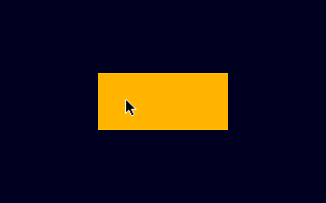
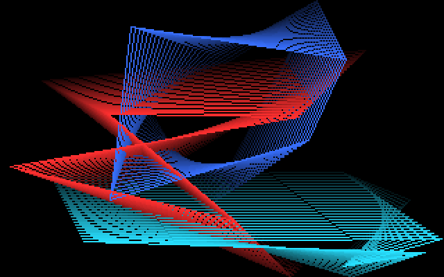
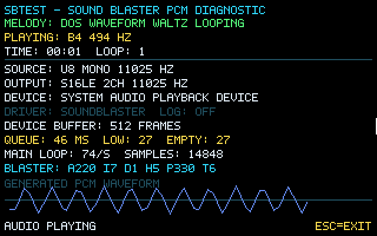
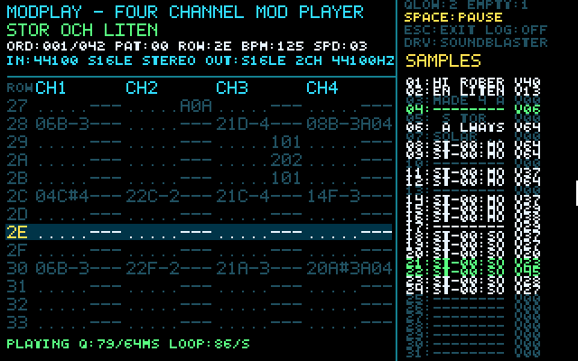
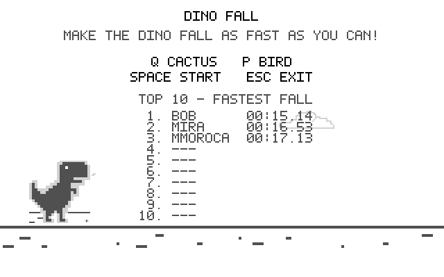
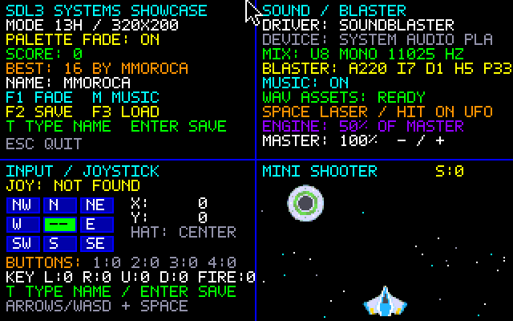
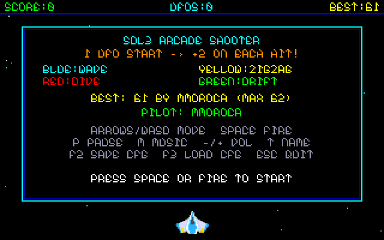
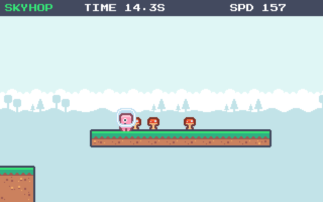
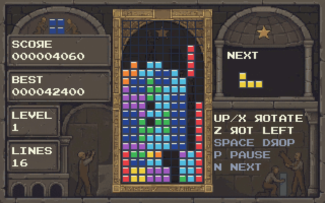
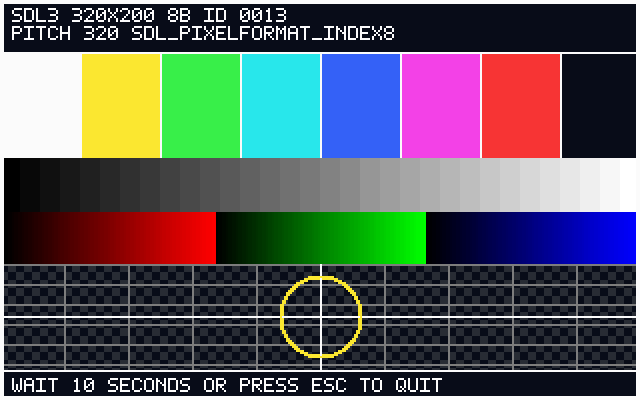

# SDL3 DOS Demo Suite

[English](README.md) · [Español](README.es.md)

**by @mmoroca & [Arena.AI](http://Arena.AI) 2026**

> [!TIP]
> **Running on a real `80386` / `386SX` / `486SX` with only `2 MB` of RAM or no FPU?** Check out the companion repository **[`mmoroca/sdl3-dos-386`](https://github.com/mmoroca/sdl3-dos-386)** — validated on a real **ADL Computers Terminator 386 (`80386SX`, `2 MB` RAM, no `80387`)** with **zero `CWSDPMI.SWP` disk swap**, stripped `~508–574 KB` `.EXE` binaries, a drop-in `dos_compat.c` layer, `CONFIG.SYS` / `AUTOEXEC.BAT` tuning tips, and a complete 386 optimization engineering guide.

A set of small C programs for MS-DOS, built with DJGPP and the SDL3 DOS backend. SDL3 is referenced as a Git submodule pinned to an upstream commit; its source remains in the SDL project and is not copied into this repository.

## Included programs

| Executable | Source | Description and controls |
|---|---|---|
| `HELLO.EXE` | `main.c` | Minimal SDL surface example at 320×200. Draws a colored rectangle and exits on **Esc** or window close; `/L` enables optional `HELLO.LOG` output. |
| `FONTDEMO.EXE` | `fontdemo.c` | Side-by-side 320×200 showcase of the four C-header bitmap fonts (`font_3x5.h`, `font_5x7.h`, `nueva_font_5x7.h`, `font_8x8.h`). **Esc** exits. |
| `MISTIFY.EXE` | `mistify.c` | Animated quadrilaterals with a 256-color palette and fading trails. Defaults: 48 trail frames, 2 polygons, normal speed. Any key or mouse movement exits. `/L` enables `MISTIFY.LOG`. |
| `SBTEST.EXE` | `soundtest.c` | Plays an original generated melody as 11025 Hz, unsigned 8-bit mono PCM and shows audio/device diagnostics. **Esc** exits; `/L` enables `SBTEST.LOG`. |
| `MODPLAY.EXE` | `modplay.c` | Plays bounded ProTracker modules (31 samples, 4 channels). Default output: 22050 Hz, 8-bit, mono. **Space** pauses/resumes and **Esc** exits. |
| `SHOWCASE.EXE` | `showcase.c` | Function-oriented SDL3 starter: 320×200 indexed display, palette fade, text/keyboard input, optional eight-way joystick, audio diagnostics and PCM effects, saved settings/high score, and a four-panel mini-shooter. **Arrows/WASD** move, **Space** fires, **T** edits the call sign, **F1** fades, **M** toggles music, **F2/F3** save/load settings, **-/+** adjusts volume, **Esc** exits; `/L` enables `SHOWCASE.LOG`. |
| `SHOOTER.EXE` | `shooter.c` | Standalone full-screen 320×200 arcade shooter built on `showcase.c`. After the SDL3-DOS logo, shows `SHOWCASE/UFO.BMP` for 5 seconds (**Esc** skips straight to the menu), then starts runs with 1 descending UFO on one of 4 color-coded patterns; each hit spawns 2 new UFOs (up to 256 active) until an enemy collides with the ship. **Arrows/WASD** or joystick move, **Space**/button 1 launches/fires, **P** pauses, **T** edits pilot name, **M**/**-/+** control audio, **F2/F3** save/load, **Esc** asks `"EXIT? Y / N"` during play, returns to the menu on Game Over, and from the main menu fades out to DOS text mode printing `"¡Gracias por jugar!"`; `/L` enables `SHOOTER.LOG`. |
| `SKYHOP.EXE` | `skyhop.c` | Independent procedurally generated 320×200 platform runner for 486+; **A/D/arrows** move, **Space/W/Up** jump, **P** pauses, **Esc** returns to menu. Survival-time Top 10. |
| `TETSDL3.EXE` | `tetrisdl3.c`, `tetris_rules.h`, `tetris_scores.h` | 486+ falling-block arcade: centered 10×20 board, 3-second splash + 3-second title, flashing clears, Kenney CC0 effects and music, named Top 10 and separate menu/leaderboard screens rotating every 5 seconds. [Game guide](TETRISDL3_DESIGN.md). |
| `DINO.EXE` | `dinorun.c` | The runner attempts to dodge automatically; random agility can make its timing imprecise. Place a cactus with **Q** or a bird with **P**. Sprites default to half size (`/s 2`); `/h` shows help. **Space** starts/pauses and **Esc** exits. The Top 10 ranks shorter times first. |
| `VTEST.EXE` | `vtest.c`, `vtest_chart.h` | 486+ BIOS VGA/VBE and SDL3 **video test card** for 320×200 through 1024×768 and advertised color depths. **B/K/S** select BIOS/banked BIOS/SDL3, **Enter** starts; each card lasts 10 seconds or until **Esc** returns to menu; **Esc** in menu exits. `/LIST`, `/LISTSDL` enumerate modes. [Bilingual guide](VTEST_GUIDE.md). |

Dino, Shooter and SKYHOP first show the reusable three-second SDL3-DOS logo with fade-in, a one-shot voice at full brightness, and fade-out; Esc skips only this logo. Copy `sdl3_splash.h` and `SPLASH/` to reuse it in another SDL3 program; see the bilingual [splash integration guide](SDL3_SPLASH_GUIDE.md). Shooter then shows its existing five-second UFO screen unchanged. `/H` prints help directly. The one header-only function borrows the game's existing window, INDEX8 canvas and optional audio stream, then restores its palette. It does not create another SDL session or alter SKYHOP's `/L` phase measurements.

## Screenshots

| Demo | Screenshot |
|---|---|
| `HELLO.EXE` |  |
| `MISTIFY.EXE` |  |
| `SBTEST.EXE` |  |
| `MODPLAY.EXE` |  |
| `DINO.EXE` |  |
| `SHOWCASE.EXE` |  |
| `SHOOTER.EXE` |  |
| `SKYHOP.EXE` |  |
| `TETSDL3.EXE` |  |
| `VTEST.EXE` |  |

The arcade graphics examples request 320×200 indexed-color surfaces where supported; **VTEST.EXE** separately probes the advertised VGA/VBE modes up to 1024×768 in BIOS and SDL3. Mistify renders with a 256-color palette; Dino Fall uses a shared grayscale palette and transparent key; Showcase and Shooter use the same RGB 3:3:2 palette as their converted sprite BMPs; SKYHOP has its own shared exact-color palette and transparent index 0. These programs use SDL software surfaces; the DOS backend uses VGA/VESA and does not require OpenGL or GPU acceleration. In-program text and command-line help are in English.

## Source organization

Each C file is organized into visible sections for configuration, state, initialization, input, the main loop, and cleanup. `dinorun.c` documents its state, resource ownership, timing/physics, randomized maneuver logic, collision-mask math, rendering, and event flow. `showcase.c` is the function-oriented starter template: display/palette, text drawing, input, joystick, audio, files, shooter update/render, main loop, and cleanup are separate functions. `shooter.c` turns that template into a standalone full-screen arcade game using pure integer/fixed-point motion and pixel-accurate sprite collision. See [`SHOWCASE_GUIDE.md`](SHOWCASE_GUIDE.md) for the bilingual function map and extension notes. `tools/convert_assets.py` remains project-neutral; `trimexe.sh` creates stripped executable copies while leaving the originals intact. Resources are released safely after partial initialization failures; there are no `goto` statements.

## Requirements

- CMake 3.16 or newer.
- Git.
- A DJGPP cross-compiler targeting `i386-pc-msdosdjgpp`, including its binutils.
- The SDL3 Git submodule at `SDL/`, pinned to an upstream commit containing the DOS backend and `build-scripts/i586-pc-msdosdjgpp.cmake`. SDL3 is **not vendored** in the project; the repository records only the submodule pointer. Initialize the submodule when cloning so the exact recorded SDL revision is checked out.
- For DOS runtime tests, a DPMI host such as `CWSDPMI.EXE`. Audio examples also require a Sound Blaster-compatible device or emulator configuration.

CMake looks for SDL3 in `SDL/` by default. To use a checkout elsewhere, pass `-DSDL3_DOS_SOURCE_DIR=/path/to/SDL` when configuring.

## Set up a DJGPP toolchain

Any compatible DJGPP toolchain can be used. The following is an optional macOS/Homebrew recipe using [build-gcc](https://github.com/jwt27/build-gcc); on other host operating systems, use the equivalent prerequisites documented by that project or an already installed DJGPP toolchain.

On macOS, install the command-line tools and the required utilities:

```sh
xcode-select --install   # only if the tools are not already installed
brew install bash gnu-sed texinfo nasm dos2unix cmake git
```

Set a configurable installation root, clone `build-gcc` there once, and build its minimal DJGPP toolchain. The default below is under the current user's home directory; set `BUILD_ROOT` to another path if desired.

```sh
export BUILD_ROOT="${BUILD_ROOT:-$HOME/build-gcc}"

if [ ! -d "$BUILD_ROOT/.git" ]; then
  git clone https://github.com/jwt27/build-gcc.git "$BUILD_ROOT"
fi

export DJGPP_PREFIX="${DJGPP_PREFIX:-$BUILD_ROOT/opt/djgpp}"
export PATH="$(brew --prefix bash)/bin:$(brew --prefix nasm)/bin:$(brew --prefix dos2unix)/bin:$(brew --prefix gnu-sed)/libexec/gnubin:$(brew --prefix texinfo)/bin:$PATH"
cd "$BUILD_ROOT"
"$(brew --prefix bash)/bin/bash" ./build-djgpp.sh --prefix="$DJGPP_PREFIX" minimal
```

Use the `minimal` target for this project; the broader `all` target may attempt to build the legacy `djgpp/default` aggregate. The prefix must be an absolute path. On Linux or another host, install the corresponding build dependencies and follow the host-specific instructions in the `build-gcc` documentation, or point `DJGPP_PREFIX` at an existing toolchain.

## Configure a terminal and get the sources

Define the project and toolchain locations in each terminal used for building. These defaults are examples and can be overridden; `DEMO_DIR` is explicitly defined so the build commands do not depend on the current working directory.

```sh
export BUILD_ROOT="${BUILD_ROOT:-$HOME/build-gcc}"
export DEMO_DIR="${DEMO_DIR:-$HOME/sdl3-dos-demo}"
export DJGPP_PREFIX="${DJGPP_PREFIX:-$BUILD_ROOT/opt/djgpp}"
export SDL3_DOS_SOURCE_DIR="${SDL3_DOS_SOURCE_DIR:-$DEMO_DIR/SDL}"

export DJDIR="$DJGPP_PREFIX/i386-pc-msdosdjgpp"
export GCC_EXEC_PREFIX="$DJGPP_PREFIX/lib/gcc/"
export PATH="$DJGPP_PREFIX/i386-pc-msdosdjgpp/local/bin:$DJGPP_PREFIX/i386-pc-msdosdjgpp/bin:$DJGPP_PREFIX/bin:$PATH"
export PKG_CONFIG_LIBDIR="$DJGPP_PREFIX/i386-pc-msdosdjgpp/local/lib/pkgconfig:$DJGPP_PREFIX/i386-pc-msdosdjgpp/local/share/pkgconfig:$DJGPP_PREFIX/i386-pc-msdosdjgpp/lib/pkgconfig:$DJGPP_PREFIX/i386-pc-msdosdjgpp/share/pkgconfig"
unset PKG_CONFIG_PATH
```

Check that the compiler targets DJGPP:

```sh
i386-pc-msdosdjgpp-gcc -v 2>&1 | grep Target
```

The output should contain `Target: i386-pc-msdosdjgpp`. Clone the project and initialize its pinned SDL3 submodule, or initialize the submodule in an existing checkout:

```sh
# Replace the project URL if the GitHub owner or repository name differs.
if [ ! -d "$DEMO_DIR/.git" ]; then
  git clone --recurse-submodules https://github.com/mmoroca/sdl3-dos-demo.git "$DEMO_DIR"
else
  git -C "$DEMO_DIR" submodule update --init --recursive
fi

export SDL3_DOS_SOURCE_DIR="${SDL3_DOS_SOURCE_DIR:-$DEMO_DIR/SDL}"
```

The submodule checkout is pinned by the parent repository, so `git submodule update --init --recursive` restores the exact recorded SDL revision. If you use a separate SDL checkout, set `SDL3_DOS_SOURCE_DIR` to that path instead.

## Build profiles

The SDL checkout supplies the DOS CMake toolchain file. The compiler is set explicitly to the DJGPP C compiler; this project is C-only.

### Normal Release build

```sh
cmake -S "$DEMO_DIR" -B "$DEMO_DIR/build-dos" \
  -DSDL3_DOS_SOURCE_DIR="$SDL3_DOS_SOURCE_DIR" \
  -DCMAKE_TOOLCHAIN_FILE="$SDL3_DOS_SOURCE_DIR/build-scripts/i586-pc-msdosdjgpp.cmake" \
  -DCMAKE_BUILD_TYPE=Release \
  -DCMAKE_C_COMPILER="$DJGPP_PREFIX/bin/i386-pc-msdosdjgpp-gcc"

cmake --build "$DEMO_DIR/build-dos" --parallel
```

The toolchain file is named `i586-pc-msdosdjgpp.cmake`; the compiler is explicitly set to `i386-pc-msdosdjgpp-gcc`. CMake creates `hello.exe`, `mistify.exe`, `sbtest.exe`, `modplay.exe`, `showcase.exe`, `shooter.exe`, `skyhop.exe`, `tetsdl3.exe`, `dino.exe`, and `vtest.exe` in the selected build directory. The `SHOWCASE/` runtime assets are copied beside the executables for both `showcase.exe` and `shooter.exe`. If changing compiler or toolchain after configuration, use a fresh build directory so CMake does not reuse the old cache.

### Release build optimized for size

Use a separate build directory to keep the normal build intact:

```sh
cmake -S "$DEMO_DIR" -B "$DEMO_DIR/build-dos-small" \
  -DSDL3_DOS_SOURCE_DIR="$SDL3_DOS_SOURCE_DIR" \
  -DCMAKE_TOOLCHAIN_FILE="$SDL3_DOS_SOURCE_DIR/build-scripts/i586-pc-msdosdjgpp.cmake" \
  -DCMAKE_BUILD_TYPE=Release \
  -DCMAKE_C_COMPILER="$DJGPP_PREFIX/bin/i386-pc-msdosdjgpp-gcc" \
  -DCMAKE_C_FLAGS_RELEASE="-Os -DNDEBUG -ffunction-sections -fdata-sections" \
  -DCMAKE_EXE_LINKER_FLAGS="-Wl,--gc-sections"

cmake --build "$DEMO_DIR/build-dos-small" --parallel
```

`-Os` favors smaller code; function/data sections and `--gc-sections` allow unused sections to be discarded. If the toolchain linker does not support `--gc-sections`, remove that linker option and the section flags; `-Os -DNDEBUG` can remain. This profile does not request 486-only instructions.

#### Create stripped copies

After building, `trimexe.sh` can make stripped copies of the executables in a build directory without changing the originals:

```sh
bash "$DEMO_DIR/trimexe.sh" "$DEMO_DIR/build-dos-small"
```

It scans only the specified directory (not its subdirectories), accepts `.exe` and `.EXE`, and creates a sibling copy with `str.exe` appended to the base name (for example, `dino.exe` becomes `dinostr.exe`). It uses `i386-pc-msdosdjgpp-strip --strip-all`, so symbols including debug symbols are removed from the copies. Existing files ending in `str.exe` are skipped, which makes repeat runs safe. The DJGPP strip utility must be on `PATH`; set `STRIP_TOOL=/path/to/i386-pc-msdosdjgpp-strip` to override it. Run `bash "$DEMO_DIR/trimexe.sh" --help` for usage and options.

### Release build for 486-class performance

This separate profile favors speed over size and targets 486 or newer processors; it is not suitable for a 386.

```sh
cmake -S "$DEMO_DIR" -B "$DEMO_DIR/build-dos-fast" \
  -DSDL3_DOS_SOURCE_DIR="$SDL3_DOS_SOURCE_DIR" \
  -DCMAKE_TOOLCHAIN_FILE="$SDL3_DOS_SOURCE_DIR/build-scripts/i586-pc-msdosdjgpp.cmake" \
  -DCMAKE_BUILD_TYPE=Release \
  -DCMAKE_C_COMPILER="$DJGPP_PREFIX/bin/i386-pc-msdosdjgpp-gcc" \
  -DCMAKE_C_FLAGS_RELEASE="-O2 -DNDEBUG -march=i486 -mtune=i486 -ffunction-sections -fdata-sections" \
  -DCMAKE_EXE_LINKER_FLAGS="-Wl,--gc-sections"

cmake --build "$DEMO_DIR/build-dos-fast" --parallel
```

To compare `-O3`, use another build directory (for example, `build-dos-fast3`) and replace `-O2` with `-O3`; do not overwrite a build configured with different flags.

A reported 486 DX2/50 test ran `MODPLAY.EXE` comfortably at 22050 Hz, 16-bit stereo. At 44100 Hz, 16-bit stereo, the reported `-O2` run generated about 44,150 frames/s with a 61 ms maximum audio-fill time; `-O3` generated about 45,090 frames/s with a 57 ms maximum. The target queue is about 65 ms, so the higher rate still has little headroom. These are hardware-specific measurements, not performance guarantees.

### Separate 80386 / 386SX low-memory edition

This repository keeps its C sources clean, readable, and free of hardware-specific workarounds (targeting 486-class or newer DOS machines and modern hosts). A companion project directory (`../sdl3-dos-386`) provides a dedicated 80386 / 386SX edition (no FPU, 2 MB RAM budget, stripped binaries, pre-baked sprite spans, and VGA/PIT compatibility shims).

## Running in DOS or DOSBox

DJGPP creates 32-bit DPMI executables. Provide a compatible DPMI host, such as `CWSDPMI.EXE`, alongside the programs unless the runtime environment supplies one. Mount the selected build directory as drive `C:` in DOSBox or DOSBox-X.

```text
C:
HELLO.EXE
HELLO.EXE /L
HELLO.EXE /H
```

`HELLO.EXE` opens a 320×200 indexed VGA display, draws its test pattern, and waits up to 5 seconds (or exits immediately on **Esc**). Logging to `HELLO.LOG` is off by default and enabled only when `/L` (`/LOG`, `-l`, `--log`) is supplied.

### Bitmap font showcase

```text
FONTDEMO.EXE
```

`FONTDEMO.EXE` renders the project's four C-header bitmap fonts side by side on a 320×200 indexed display (`font_3x5.h`, `font_5x7.h`, `nueva_font_5x7.h`, and `font_8x8.h`), generated from PNG glyph strips with `tools/genfont.py`. Press **Esc** to return cleanly to MS-DOS.

In `python3 tools/genfont.py`, select a glyph and click **Copiar** (or press Ctrl+C / Cmd+C), select another character such as R, then click **Pegar** (Ctrl+V / Cmd+V). The copied pixels become an editable **draft** for the destination; its character code stays R and the source remains unchanged. Press **OK** to include the edited glyph in the exported C font. Pasting over a nonempty drawing asks for confirmation; copying and pasting via shortcuts does not intercept normal text-field clipboard use. The internal glyph clipboard only works at the same grid size.

### Systems Showcase template

```text
SHOWCASE.EXE
SHOWCASE.EXE /L
SHOWCASE.EXE /H
```

`SHOWCASE.EXE` requests the SDL3 DOS backend's 320×200 indexed display (Mode-13h-style; it does not issue BIOS interrupts), then ramps the RGB 3:3:2 palette from black to full color. Four panels show general state and a rainbow-text palette, audio/`BLASTER` diagnostics, keyboard/text/joystick input, and a black-background starfield shooter. The three Kenney sprites are indexed BMPs drawn at 1:4 size (28×19 ship, 23×23 UFO, 4×10 laser). Source OGG music/effects are supplied as 11025-Hz unsigned 8-bit mono WAVs; the DOS target uses SDL3 core audio and does not link SDL3_mixer. See [`SHOWCASE_GUIDE.md`](SHOWCASE_GUIDE.md) for why and for the supported SDL3_mixer alternative.

Controls: **arrows/WASD** move; **Space** or joystick button 1 fires; **T** starts call-sign text entry, **Backspace** edits, and **Enter** saves it; **F1** toggles the palette fade; **M** toggles music; **F2/F3** save/load `SHOWCASE.CFG`; **-/+** adjust master volume; **Esc** exits with a palette fade-out. The engine clip is mixed at exactly half the master volume. A new best shooter score is written immediately to `SHOWCASE.SCO`. Both files are plain-text runtime data in the current directory and are ignored by Git. A joystick is optional; without one, the display reports its absence and the keyboard remains usable. See [`SHOWCASE_GUIDE.md`](SHOWCASE_GUIDE.md) for the function-by-function overview and asset conversion details.

### Arcade Shooter

```text
SHOOTER.EXE
SHOOTER.EXE /L
SHOOTER.EXE /H
```

`SHOOTER.EXE` adapts the `showcase.c` foundation into a full-screen 320×200 arcade game. After the shared SDL3-DOS startup it displays the full-screen 320×200 indexed presentation screen `SHOWCASE/UFO.BMP` (`showcase-src/UFO.png`) for 5 seconds before transitioning to the title menu, and pre-bakes the six indexed gameplay sprites (`PLAYER~1.BMP`, `UFOBLUE.BMP`, `UFOYEL~1.BMP`, `UFORED.BMP`, `UFOGREEN.BMP`, and `LASERR~1.BMP`) at 1:4 size into compact contiguous buffers so the scanline blitter stays friendly to a 486 L1 cache even with hundreds of enemies on screen. Audio mixes the 11025-Hz mono PCM WAV effects using pure integer and 24.8 fixed-point math (no FPU required), the mouse cursor is hidden while running, and exiting via **Esc** fades the palette out, restores MS-DOS text mode (`SDL_Quit`), and prints `"Gracias por jugar!"` right before returning to the DOS prompt (`F1` manual fade is removed; `F2`/`F3` save/load `SHOOTER.CFG`).

Each run starts with **1 UFO** descending from the top on one of four color-identified behaviors: **blue** = sinusoidal wave, **yellow** = timed diagonal zigzag, **red** = alternating fast swoop dives, and **green** = diagonal drift with course shifts. Destroying an enemy increments the score and immediately spawns **2 new descending UFOs** (`ENEMIES_PER_KILL = 2`, raising the simultaneous active pool up to `MAX_ENEMIES = 256`, plus an overflow queue). Enemies reaching the bottom wrap back to the top with a new random X position and behavior/color. Collisions check non-transparent pixels after fast vertical/bounding-box rejection; the run ends immediately when an enemy sprite impacts the player ship. Settings and records are stored in `SHOOTER.CFG` and `SHOOTER.SCO`; passing `/L` (or `/LOG`) enables optional startup/summary logging to `SHOOTER.LOG` (off by default, with zero per-frame disk I/O during gameplay, and ignored by Git).

### Reusable SDL3-DOS logo intro

The single function in [`sdl3_splash.h`](sdl3_splash.h) runs **after** Dino, Shooter and SKYHOP initialize their own video/audio but before their game loops. It does not open another SDL window, drawing canvas or sound device (SDL_LoadBMP uses one temporary image surface). Keep `SPLASH/SDL3DOS.BMP` and `SPLASH/ZARVOX.WAV` with the executable. It temporarily uses the logo's exact 12 colors on the game's indexed canvas, then restores the game's original palette. It fades the logo in over 0.5 s, holds it for 2 s and fades it out over 0.5 s (**3 s total**), starting the ~0.94 s WAV as soon as fade-in completes. Esc continues immediately, closing the splash window quits; missing audio produces a silent picture, and missing splash assets do not block the game. Runtime resources can be regenerated from `splash-src/` with `python3 tools/convert_sdl3_splash.py splash-src SPLASH` (standard library only). See [SDL3_SPLASH_GUIDE.md](SDL3_SPLASH_GUIDE.md) for the one-call API, audio-format requirement and tests. The splash audio/artwork has separate provenance; do not assume the code's MIT license covers it.

### SKYHOP — endless platform runner (486+)

For a source-level reading map, **phase transition table**, timing rationale and steps to rebuild or adapt the game, see the bilingual [SKYHOP source guide](SKYHOP_GUIDE.md). The comments in `skyhop.c` follow the same structure.

```text
SKYHOP.EXE
SKYHOP.EXE /H
SKYHOP.EXE /L
```

**Space/Enter** starts a run; **A/D or left/right arrows** move; **Space, W, or Up** jumps (release before jumping again); **P** pauses/resumes; **Esc** returns from play/pause to the title, or quits from the title. On Game Over, type up to eight **A–Z/0–9** characters (Backspace edits) and press **Enter** to save a qualifying time. The best **10 longest survival times** appear on the title screen and are stored as milliseconds in `SKYHOP.SCO` in the **current working directory**. This file is ignored by Git. On the title screen, each row reserves 2 characters for rank, 8 for name, and a fixed `000.0S` time; displayed times above 999.9 seconds are shown as `999.9S` while their exact milliseconds remain saved and ranked. Only `/L` (`/LOG`) creates `SKYHOP.LOG`; ordinary runs never write a log.

#### Measure SKYHOP performance on DOS hardware

Run `SKYHOP.EXE /L` from a **writable** current directory. Wait at least 10 seconds on the title, play for 20–30 seconds, return to the title with Esc, then press Esc again to exit normally. Send the resulting `SKYHOP.LOG` (and note the CPU, RAM and video card/mode). Copy the log before another `/L` run: a new run replaces it. `/L` is the only option that enables this log; normal runs make no log or per-frame timing calls. There is **no per-frame disk writing**: measurements accumulate in RAM, with summaries approximately every 5 seconds, at phase changes and on clean exit.

If SKYHOP exits before its title, `/L` now flushes `STARTUP` checkpoints at option parsing, score loading, SDL video, sprites, window/surface, audio, intro and loop entry. The last checkpoint (or `required_image_error`/`init_failed`) helps locate an early failure; `intro_end result=0/1/2/3` means completed/skip/quit/unavailable. These are **startup-only** writes, never per-frame. A missing, corrupt or palette-incompatible required `Images/PLATFORM/*.BMP` also prints its relative filename and reason on the DOS console **without `/L`**, after text mode is restored; leave the DOS prompt open to read it. Jump/loss WAVs contain ~60-70 ms of leading silence; sound routines play the supplied assets unmodified. The three programs call the shared intro at distinct lifecycle points; see the call-site table in [SDL3_SPLASH_GUIDE.md](SDL3_SPLASH_GUIDE.md).

`PERF setup` reports the actual SDL screen size, pixel format, pitch, indexed canvas and whether the two surfaces are shared. For each `phase`, the `PERF` lines report wall time, loop frames/FPS, **`drawn`/`draw_fps` (actual screen redraws)** and **average/maximum milliseconds** for `events`, `physics`, `audio`, `clear` (lock + background), `sky`, `terrain` (platforms + character), `hud_menu` (HUD, title and Top 10), `present` (including any index-to-screen conversion and SDL video transfer), `delay` and the full `frame`. On static screens (title, pause and game over), rendering is skipped until something changes while audio continues: rendering-stage averages use `drawn` as the divisor; event/audio/frame averages use all loop frames. The 16 ms target is a **soft pacing goal** of about 62.5 loop iterations/s (near 60 Hz), **not** VGA sync or a hard frame budget: an iteration waits only for the unused part of 16 ms; an overdue iteration calls `SDL_Delay(0)` to yield the cooperative DOS audio scheduler without adding a fixed delay. Separately, physics uses <=8 ms substeps and clamps an unusually long elapsed delta to 64 ms. `work_gt16` counts frames whose work before that adaptive delay exceeded 16 ms. During play, `raw_ms` is elapsed wall time, `simulated_ms` is the time the physics received, and `capped64` counts frame deltas truncated to 64 ms. High `capped64` can make the displayed survival time fall behind real time. Logging and timing probes themselves add some overhead; compare with a normal run. Only logs obtained on the target hardware are hardware performance measurements; an emulator is not a substitute.

The HUD shows title, survival time and current scrolling speed in px/s. Scroll starts at 72 px/s and increases by about 6 px/s every second of active play without a gameplay cap. Ground with randomized gaps of 18–108 px and elevated platforms are streamed as 18 px tiles; randomized decorations have **no collision**. Ground acceleration and friction provide a brief run-on after releasing a direction, then the character stands still at the same point in the world while the scrolling screen moves it left. Horizontal world speed starts at zero, rises smoothly to a maximum while a direction is held, and decays when released: quickly on the ground, slowly in the air. Pressing the opposite direction brakes much faster; an airborne jump cannot reverse its horizontal direction before landing. At the left screen edge it stays visible but the scrolling terrain drags it along; touching that edge does not itself kill it, though it will fall if the supporting surface ends. Pressing Right can always overcome the current scroll speed. The 24 px animated character moves under integer gravity; the sky uses two full-width, static color bands matching the originally solid upper/lower tiles. Only the randomly selected 24-pixel middle tiles are drawn individually, at **one quarter** of the camera's speed; the 18-pixel ground tiles are independent. Cover artwork uses `font_10x10.h`; the HUD and other text use `font_7x7.h`. The generator has a traversable jump route, but timing and steering remain the player's challenge, especially as speed rises.

Keep `Images/PLATFORM/` next to the executable in that relative layout (or launch it from a build directory with that folder). The 21 indexed BMP sprites share one exact 256-entry palette with transparent index 0; SDL3 loads them without SDL_image. Source PNGs are in `Images-src/PLATFORM/`, and `python3 tools/convert_platform_assets.py Images-src/PLATFORM Images/PLATFORM` regenerates the BMPs using only Python's standard library. The three user-supplied OGG tracks (`docs/platform_musica.ogg`, `platform_salto.ogg`, `platform_pierde.ogg`) are converted offline to `Images/PLATFORM/MUSIC.WAV`, `JUMP.WAV`, `LOSE.WAV` (11025 Hz, unsigned 8-bit mono) with `sh tools/convert_platform_audio.sh docs Images/PLATFORM` (requires FFmpeg **only for conversion**). SDL3 mixes looping background music during the title and play, pauses music during pause, and plays separate jump and loss effects. Missing audio hardware disables sound without preventing gameplay. Keep these three WAVs with the BMPs; no OGG decoder is required at runtime. This **game-specific** converter does not change `tools/convert_assets.py` or its generic RGB 3:3:2 behavior. The graphics provenance and the audio files supplied by the owner are listed in [`THIRD_PARTY_NOTICES.md`](THIRD_PARTY_NOTICES.md); the project's MIT license does not relicense the art. No 386 edition has been made for this game. The owner confirms the Kenney SKYHOP audio is CC0 1.0, like the Shooter audio; no particular audio pack name is asserted.

To build only SKYHOP with the 486 profile above: `cmake --build "$DEMO_DIR/build-dos-fast" --target skyhop --parallel`. For native regression tests, configure a **separate** host build with `-DSKYHOP_BUILD_TESTS=ON -DSDL_UNIX_CONSOLE_BUILD=ON -DSDL3_DOS_SOURCE_DIR=/path/to/SDL`, build `skyhop_tests`, and run `ctest --test-dir /path/to/host-build --output-on-failure` (Linux/offscreen video). The regression suite exercises 2,000 generated jump pairs at five speeds, ground/air inertia and left-edge drag, fixed-width Top 10 columns/layout, exact sky-band colors and pixel-for-pixel equivalence at four camera offsets, static-screen invalidation, WAV loading, screen rendering, state transitions, and Top 10 persistence. Building a DOS executable or passing native tests alone does **not** establish performance on real 486 hardware.

### Dino Fall

```text
DINO.EXE
DINO.EXE /s 1
DINO.EXE /s 2
DINO.EXE /s 3
DINO.EXE /h
```

The dinosaur attempts to jump over cacti and duck under birds. Its agility is randomized for each obstacle: an offset from 100 ms early to 260 ms late shifts cactus takeoff away from the calculated safe point, while for birds it shifts duck onset later and releases the duck early (or, for negative rolls, starts sooner). A poor roll can make either maneuver imprecise, and direct collisions are checked against the sprite masks. The title screen reads “MAKE THE DINO FALL AS FAST AS YOU CAN!” Place obstacles in its path: **Q** places a cactus and **P** places a bird. **Space** starts a run, pauses/resumes it, or starts another run after a collision; **Esc** exits. A three-note high melody plays on a jump and a four-note low melody on a loss when audio is available.

Sprite size 2 (half-size) is the default. `/s 1` displays source sprites at full 1:1 size, `/s 2` draws them at half size, and `/s 3` selects the previous smallest custom-scaled size; the display remains 320×200. `/h` shows help. For compatibility, `--native-sprites`, `--half-sprites`, and `--scaled-sprites` remain aliases for sizes 1, 2, and 3; `--help` also works. Game Over and Reset follow the selected size: at size 2, the 386×40 title is 193×20 and the 75×101 reset icon rounds up to 38×51 pixels. Odd half-size dimensions round up to a whole pixel.

Each run ends when the dinosaur collides. The run duration is recorded in milliseconds; **shorter times rank higher**. The player starts with 2 charges and a capacity of 6; one charge is replenished every 5 seconds initially, and the capacity grows by 1 every 30 seconds. Refill time decreases by 0.5 seconds every 10 seconds, down to 2 seconds. The placement cooldown starts at 0.4 seconds and drops by 0.05 seconds every 15 seconds, down to 0.15 seconds. Each obstacle gets an independent random agility error from 100 ms early to 260 ms late. For cacti it shifts the jump takeoff away from the calculated safe window; for birds it shifts duck onset later and releases the duck earlier, so a poor roll can cause a direct collision. Negative values favor earlier movement. The jump arc still adapts to cactus size and speed. The runner starts at 104 px/s, ramps gradually, and caps at 190 px/s. Placement spacing enforces a 350 ms travel gap plus an 8-pixel margin and the runner width. The gameplay HUD shows time, supply, and speed; the old `CD` cooldown meter, temporary placement/wait messages, and bottom control footer have been removed. The controls are listed above.

The local Top 10 is stored as plain text in `DINO.SCO` in the current working directory. If a run qualifies, enter a name of up to 8 letters, digits, hyphens, or underscores. `DINO.SCO` is runtime data and is ignored by Git. The game loads the runner, birds, six cactus variants, clouds, track, game-over title, and reset icon from the local `Images/` folder. The preferred layout keeps its DOS-friendly subfolders and filenames (for example, `Images/DINO/RUN1.BMP`); the loader also tries common flattened BMP layouts beside the executable. The PNGs are not loaded directly. It searches beside `DINO.EXE` first, then in the current working directory. CMake copies `Images/` beside the executable; if you move the executable, copy that whole folder alongside it. The BMPs are 8-bit grayscale/indexed with a transparent palette key, so no SDL_image library is required.

The checked-in runtime BMP set in `Images/` uses the game's shared grayscale palette and transparent index 5. `tools/convert_assets.py` is a separate, general-purpose PNG-to-BMP utility: run `python3 tools/convert_assets.py PNG_SOURCE_DIRECTORY BMP_OUTPUT_DIRECTORY`. It recursively converts non-interlaced PNGs, preserves their dimensions (no fixed 320×200 limit; bounded by the BMP format and available memory), and writes 8-bit BMPs that all share a 256-entry RGB 3:3:2 palette. Long names receive deterministic uppercase DOS 8.3 aliases. Transparent pixels are composited over black by default; choose another matte with `--matte RRGGBB`. `--clean` removes stale BMPs after successful conversion, while preserving the newly generated BMPs and non-BMP files. The utility uses only Python's standard library. Its shared RGB 3:3:2 palette is not the game's grayscale/transparency-key palette, so don't use it to overwrite the current `Images/` runtime assets without deliberately changing the game's palette handling.

### Mistify

```text
MISTIFY.EXE /H
MISTIFY.EXE /T 64 /P 3 /S 1
MISTIFY.EXE /T 64 /P 3 /S 1 /L
```

`/T` sets trail length in frames (1–100), `/P` sets the number of quadrilaterals (1–8), and `/S` sets speed (`1` fast, `2` normal, `3` slow). `/L` enables `MISTIFY.LOG`; logging is off by default and does not write a line per frame. Any key or mouse movement exits. The pointer is hidden while the demo runs. Mistify requests an `INDEX8` surface and configures a 256-color palette; if the DOSBox-X window uses true color, SDL converts the indexed surface to the display format.

### Sound test

```text
SBTEST.EXE /H
SBTEST.EXE
SBTEST.EXE /L
```

The test generates its own 11025 Hz, unsigned 8-bit mono melody in 256-sample blocks and maintains a short SDL audio queue. The screen reports the selected device/driver and formats, queue depth, low/empty-queue events, generated samples, loop rate, and a waveform. `/L` enables `SBTEST.LOG`, which records setup and periodic diagnostics rather than every sample. Press **Esc** to stop playback and exit.

The DOS SDL backend uses the `BLASTER` environment variable. In DOSBox-X, configure the emulated card and make sure `BLASTER` agrees with its actual resources. For example, `A220 I5 D1 H5 T6` was used in one tested Sound Blaster-compatible setup; values vary by hardware and should not be copied blindly. If initializing a PnP card with UNISOUND, set the correct `BLASTER` values before running UNISOUND.

### Four-channel MOD player

`MODPLAY.EXE` accepts one `.MOD` file (case-insensitive extension). The current parser is limited to ProTracker-style modules with 31 samples and four channels, recognized by `M.K.`, `M!K!`, `FLT4`, `4CHN`, or `N.T.` signatures.

```text
MODPLAY.EXE /H
MODPLAY.EXE MUSIC\SONG.MOD
MODPLAY.EXE /R 11025 /B 8 /C MONO MUSIC\SONG.MOD
MODPLAY.EXE /R 44100 /B 16 /C STEREO /L MUSIC\SONG.MOD
```

Defaults are **22050 Hz, 8-bit, mono**. `/R` accepts `11025`, `22050`, or `44100`; `/B` accepts `8` or `16`; `/C` accepts `MONO`/`STEREO` or `1`/`2`. These select the PCM mix format; SDL may convert it to the device's supported format. **Space** pauses/resumes and **Esc** exits.

The player mixes four PCM voices and supports common ProTracker effects, including arpeggio, slides, portamento, vibrato, sample offset, volume slide, pattern jump/break, speed/BPM, and several `E` sub-effects. Eight-bit playback uses nearest-neighbor sample reads; 16-bit playback uses linear interpolation. The target audio queue is about 65 ms. The UI refreshes at 10 Hz, drawing a full frame initially and then updating changed regions with SDL dirty rectangles. Transfer savings depend on the video mode; a linear framebuffer path may still copy the full screen. This is not a complete tracker implementation, so uncommon effects may be ignored and playback can differ from a full-featured MOD player.

`/L` enables `MODPLAY.LOG`, which records module/audio setup, playback position, and periodic audio-fill and drawing-time statistics. Logging is off by default. Audio-queue-empty events are useful warning signals but do not necessarily mean the hardware buffer has already run out of sound.

## TETRISDL3: illustrated 486+ arcade, records and sound

Run `TETSDL3.EXE` with `SPLASH/` and `TETRIS/` beside it. The borrowed SDL3-DOS logo plays for three seconds (Esc skips it); the separate illustrated title **fades in over ~320 ms** of its three-second presentation, with **no ENTER SPACE ESC text overlay** (the same keys still open the menu immediately at full brightness). **MENU and TOP 10 are separate screens that alternate every five seconds**: Enter begins a game and Esc quits from either one. During play Left/Right move, Down soft-drops, **Up or X rotate clockwise**, Z rotates anticlockwise, Space hard-drops, P pauses, N toggles NEXT, and Esc **freezes play or the three row flashes** and displays `PAUSED / EXIT? Y / N`. Y abandons, N resumes the exact prior state; Esc while the question is visible cancels like N. During a flash, Y abandons **without finishing its pending clear**. Controls for both rotations appear on the menu **and** in-game HUD. `/H` prints help; `/L` optionally logs phase/error events to `TETSDL3.LOG` (disabled by default).

Four-cell line clears use 40/100/300/1200 × (previous level + 1) points; level begins at 0 and rises every ten lines. Gravity follows the approved 60 Hz logical table (level 9 = **6** ticks; 29+ = **1**), with full-interval contact lock and no wall kicks. A completed row **flashes three times over about half a second**, then disappears, and **only then** do scoring, level update and next-piece spawn occur. A first contact triggers `FALL.WAV`, a successful rotation `CLICK.WAV`, defeat `OVER.WAV`, a level increase `LEVEL.WAV`, and a four-line clear `TETRIS.WAV`. Two simultaneous effects are mixed on one SDL stream; game audio remains optional when the hardware device is unavailable, but missing/malformed WAV assets report their filename and stop startup.

A score above zero that qualifies for the Top 10 **on defeat or on confirming abandonment with Y** prompts for a 1–8-character A–Z/0–9 name; Backspace edits, Enter saves and opens the dedicated Top 10 page, and Esc cancels without writing. Ties keep the earlier entry ahead. `TETSDL3.SCO` stores up to ten named records (level and points) in its one supported format. Unknown/invalid files are reported and left untouched when read, while the game continues with an empty table. The on-screen leaderboard **always displays positions 1–10**; missing entries show `........` (name), `..` (level), and `.........` (points), without saving placeholder records. Saves use `TETSDL3.TMP` and a temporary backup `TETSDL3.BAK`. A direct window close cannot assign a name to a qualifying score. Use a writable current directory.

The menu and Top 10/name entry now use the **same** owner-created brick background, `tetris-src/menu-juego-tetsdl3.png` → `TETRIS/RECORDS.BMP`, with the identical darkened region `x=20,y=16,w=280,h=162`. The menu uses a one-pixel dark shadow under **ENTER START**, and the records header **TOP 10** uses the same shadow. Only the menu overlays the attached transparent **111×25** `tetris-src/logo tetris mini.png` → `TETRIS/LOGO.BMP`, horizontally centered with its **top edge at y=29**; the records screen keeps its TOP 10 heading. Transparent logo index 0 leaves the dark wall visible between letters. There is no MENU.BMP or separate title-text overlay; the former `tetris-src/MENU.png` is preserved unmodified as an unused alternative. `TITLE.BMP` from the newly attached **`TITLE.png`** (replacing the earlier v4 PNG and correcting the ARCADE lettering) and `GAME.BMP` from `fondo-juego-tetsdl3.png` remain. The records screen still has no ENTER PLAY ESC QUIT footer or shaded bottom strip (keys continue working). All four required DOS BMPs `TETRIS/{TITLE,RECORDS,GAME,LOGO}.BMP` use one generated palette in `fonts/tetris_art_palette.h`: regenerate together with `python3 tools/convert_tetris_art.py tetris-src TETRIS fonts/tetris_art_palette.h` (standard library only, no Pillow). The converter deletes stale `TETRIS/MENU.BMP`; remove it yourself if copying into an older DOS folder. Missing/invalid BMPs report their DOS-style `TETRIS\NAME.BMP` filename. An obsolete build tree can also produce an EXE with an out-of-sync compiled palette: if sources and BMPs are unchanged but this happens after rebuilding, regenerate the build directory and deploy the newly built EXE together with the matching four BMPs and palette header. Changing only text/shadows does **not** require reconverting the artwork. The art is not automatically MIT or Kenney CC0; see [resource notices](THIRD_PARTY_NOTICES.md). The other demos' generic RGB 3:3:2 converter is untouched.

Esc at the menu or Top 10 **fades the palette out over ~320 ms**, then closes SDL (restoring MS-DOS text mode) and prints exactly `Thank you for playing!` to the console. This Shooter-style title fade-in / exit fade-out is the default for future minigames unless specified otherwise; neither fade creates a second SDL session.

## License and third-party software

The project-authored code and documentation are licensed under MIT; see [`LICENSE`](LICENSE). That grant does not cover third-party assets. The existing Dino Fall artwork has its own provenance note in [`Images-src/README.md`](Images-src/README.md). The new Showcase sprites and source OGG tracks are from Kenney's *Space Shooter Remastered (1.0)* and are CC0 1.0; converted BMP/WAV runtime files are derivatives of those assets. See [`showcase-src/README.md`](showcase-src/README.md), [`Images-src/PLATFORM/README.md`](Images-src/PLATFORM/README.md), and [`THIRD_PARTY_NOTICES.md`](THIRD_PARTY_NOTICES.md). SDL3 is an external Git submodule and remains under its upstream zlib license; its source is not vendored, and its `LICENSE.txt` remains authoritative.

## References

- [SDL3 DOS 386 Edition (`mmoroca/sdl3-dos-386`) — Real `80386` / `386SX` (`2 MB` RAM, No-FPU) optimized sister repository](https://github.com/mmoroca/sdl3-dos-386)
- [Upstream `i386` `CPU_haveCPUID()` fix (`libsdl-org/SDL#16573`)](https://github.com/libsdl-org/SDL/pull/16573)
- [SDL3 DOS README](https://wiki.libsdl.org/SDL3/README-dos)
- [SDL3 CMake README](https://wiki.libsdl.org/SDL3/README-cmake)
- [SDL licensing](https://www.libsdl.org/license.php)
- [DOSBox-X capture menu](https://dosbox-x.com/wiki/DOSBox%E2%80%90X%E2%80%99s-Drop%E2%80%90Down-Menus)
- [build-gcc DJGPP cross-compiler](https://github.com/jwt27/build-gcc)
